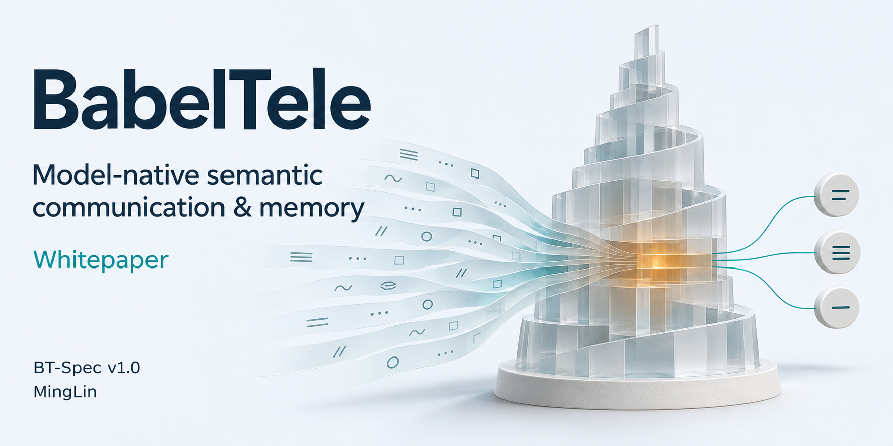
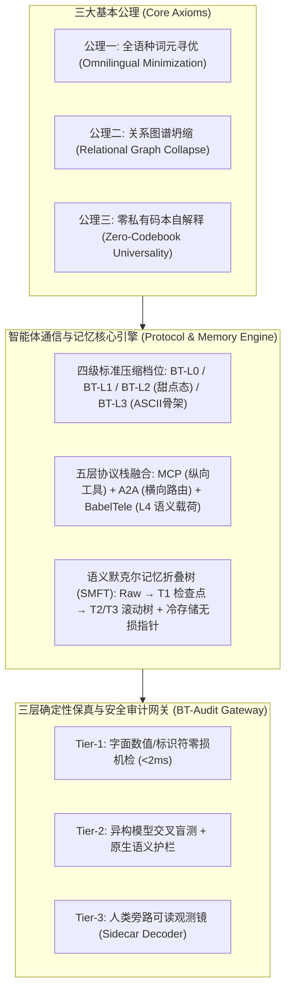

<div align="center">



# 🗼 巴别语体系白皮书 · BabelTele Whitepaper
### *A Model-Native High-Density Semantic Communication & Memory System*

**[🇨🇳 简体中文](./README.md)** · **[🇬🇧 English Edition](./README_EN.md)** · **[📖 在线电子书站点 (GitHub Pages)](https://minglink.github.io/BabelTele-Whitepaper/)** · **[📥 下载 PDF 排版发行版 (Releases)](https://github.com/Minglink/BabelTele-Whitepaper/releases/latest)**

[](./WHITEPAPER.md)
[](https://minglink.github.io/BabelTele-Whitepaper/)
[](https://github.com/Minglink/BabelTele-Whitepaper/releases/latest)
[](https://arxiv.org/abs/2606.19857)
[-181717?style=flat-square&logo=github)](https://github.com/Minglink)
[](./LICENSE)

**「人类用 MCP 与 A2A 修建了智能体世界的通信管道；而巴别语（BabelTele），定义了流淌在管道里的硅基原生语言。」**

[📜 **阅读中文单卷本 (`WHITEPAPER.md`)**](./WHITEPAPER.md) · [🌐 **Read English Whitepaper (`WHITEPAPER_EN.md`)**](./WHITEPAPER_EN.md) · [📥 **下载中文 PDF**](https://github.com/Minglink/BabelTele-Whitepaper/releases/download/v1.0.0/BabelTele-Whitepaper-v1.0-zh.pdf) · [📥 **Download English PDF**](https://github.com/Minglink/BabelTele-Whitepaper/releases/download/v1.0.0/BabelTele-Whitepaper-v1.0-en.pdf)

</div>

---

## 📖 什么是巴别语体系（The BabelTele System）？

长期以来，即便通信的**发送方与接收方都是大语言模型**（如多智能体协同、Agent 长期记忆存储、超长上下文 RAG 注入），我们依然强迫它们使用迁就人类阅读习惯的自然语言交谈——承担着高达 **60%～75% 的“人类可读性税”（语法缓冲、单语种拼写低效与线性从句展开开销）**。

**巴别语标准体系（BT-Spec v1.0）** 旨在彻底剥离机器间通信的人类语法冗余，构建一套无需修改模型权重、纯黑盒 API 兼容且支持异构跨模型零样本直读的高密度语义底座。

### 一眼看懂巴别语坍缩（Intuitive Examples）

| 场景 | 传统人类自然语言（高冗余） | 巴别语标准编码（模型零样本直读） | 压缩收益 |
| :--- | :--- | :--- | :---: |
| **科学机理** | *"During photosynthesis, plants take in carbon dioxide and water. The water is oxidized, losing electrons, while the carbon dioxide is reduced, gaining electrons. This transforms them into oxygen and glucose."* | `🌿光合: CO2+H2O ⇨(ox/red)⇨ O2↑ + Glucose. 💧-e⁻, CO2+e⁻.` | **`45 → 11` tokens**<br>*(缩减 75.6%)* |
| **商业决策** | *"Q3 revenue is projected to rise ~30% YoY; if it lands, the Berlin team ships the mobile app in October."* | `Q3rev📈~30%YoY; ?lands⇒Berlin👥🚀📱@Oct` | **`24 → 9` tokens**<br>*(缩减 62.5%)* |
| **安全网关** | *"If the JWT header algorithm is set to 'none' or the expiration timestamp is missing, immediately reject the request with HTTP 401 except on public healthcheck endpoints."* | `?JWT.alg=='none' ∨ ¬JWT.exp => reject(401) !endpoint:/healthz` | **`33 → 13` tokens**<br>*(缩减 60.6%)* |

---

## 📊 核心实证指标速览（Verified Empirical Benchmarks）

| 评测维度 | 核心实验表现 | 数据出处与设置 |
| :--- | :--- | :--- |
| **极致密度与保真解耦** | 文本体积浓缩至原长 **`27.9%`** 时，依然维持 **`99.5%`** 下游语义保真度 | `arXiv:2606.19857` 任务无关长文档阅读理解测试 |
| **异构多智能体通信** | 削减 **`44.21%`** 通信 Token 开销，任务总分保持基线的 **`99.7%`** | DeepResearch Bench（Gemini 3.1 Pro $\leftrightarrow$ GPT-5.4 零样本互通） |
| **Agent 长期会话记忆** | 节省约 **`51%`** 记忆查询 Token，准确率 **`96.48%`**（优于传统自然语言摘要） | LoCoMo 多会话长程对话记忆基准 |
| **突破物理窗口天花板** | 将 **`1.65M tokens`** 超大代码仓库分块浓缩喂入 `200K` 模型，准确率跃升 **`+10.34%`** | LongBench v2 Code Repo QA Long（GLM-5.1：`62.07% → 72.41%`） |

---

## 🏗️ 巴别语体系全景架构（System Architecture）



---

## 🛠️ 官方旗舰实现：巴别语 Agent（`babeltele-agent/`）

本仓库内置基于开源智能体基础设施 **[`deepseek-ai/deepseek-harness`](https://github.com/deepseek-ai/deepseek-harness)**（MIT 协议）进行**全栈底层源码重构**的 **巴别语 Agent（[`babeltele-agent/`](./babeltele-agent/)）**，将 `BT-Spec v1.0` 双平面硅基协议直接固化编译进底层核心引擎与极简线条风格前端组件树（非外挂包装）：

| 旗舰目录 | 核心定位 | 底层重构核心亮点 | 快速启动（内置 Web 界面 + CLI） |
| :--- | :--- | :--- | :--- |
| **[`babeltele-agent/`](https://github.com/Minglink/BabelTele-Whitepaper/tree/main/babeltele-agent)** | **巴别语 Agent（BabelTele Agent · V3 全栈底层源码重构版）** | • **V3 双平面极速内核与全语种语义坍缩**（`packages/core/system-prompt` & `agent-loop`）：内置 `BT-L2 / BT-L3` 双档全语种脱水器（缩减 `~51.6%` 输入词元，`100%` 硬锚点锁定）、`#Chat[fast]` 问候快路径（输出词元下降 `53.8%`）、`[BT-ToolOut]` 工具输出双向折叠（单测通过噪音缩减 `83.9%`）与并行批处理工具调度；`deepseek-flash` 真机单轮提速 **`3.58x`**，多步全链路工程实现+单测总耗时从 `101.55s` 降至 **`64.08s`（提速 `1.58x`，总上下文吞吐下降 `36.7%`）**<br>• **零盲探 `[BT-Headers v3.0]` 骨架与 `[SMFT-T1]` 压缩**（`working-directory`、`compaction-basic`、`tool-subagent`）：基于 `mtime` 指纹实时提取顶层 AST 符号，空白目录显式注入 `@cwd=(empty_directory)` 消除首步盲探；`/compact` 输出缩减 `74.8%` 体积的 `[SMFT-T1]` 检查点；父子智能体原生采用 `#SubTask` / `#SubReport` 并发协同<br>• **Plane-B 源码零污染门禁 & Windows 终端优化**（`tool-fs` & `pwsh-local`）：底层硬拦截任何 `#BT` 符号污染并消除 PowerShell 原生 `stderr` 误报，确保 `.py` / `.java` / `.ts` / `.go` 等产出代码 **100% 原生纯净**<br>• **极简细线条原生界面**（`ui-primitives` / `ui-conversation` / `ui-chat`）：传承 DeepSeek 极简线条美学，支持 `BT-L2 / BT-L3` 档位切换、自动提纯与思考流一键中文透视 | Windows 双击 `babeltele-agent/启动巴别语Agent.bat`<br>或执行：<br>`cd babeltele-agent && pnpm web` |

---

## 📚 白皮书分章节深度规范目录（Modular Specification）

若您希望快速通读全貌，推荐先阅读单文件完整典藏版 **[`WHITEPAPER.md`](./WHITEPAPER.md)**；若您需要查阅数学推导、算子词典、全量模型对比表或复制工程提示词，请进入 `docs/` 分册：

| 章节 | 文档链接 | 核心内容提要 |
| :---: | :--- | :--- |
| **单卷本** | **[`WHITEPAPER.md`](./WHITEPAPER.md)** | **《巴别语：一种模型原生的高密度语义通信与记忆体系》完整单页典藏版**（致敬经典白皮书十节体例） |
| **第 01 章** | **[人类可读性税与巴别塔隐喻](./docs/01-manifesto-and-problem.md)** | 碳基自然语言的四大冗余根源、MCP/A2A 通道之后的载荷革命、巴别塔与 1866 电报体的双重隐喻 |
| **第 02 章** | **[信息论基础与解耦定理](./docs/02-theoretical-foundations.md)** | 率失真语义投影方程、Dale-Chall 与 8 款基座模型 PPL 暴涨 20 倍实证、三元解耦定理与潜空间同构假说 |
| **第 03 章** | **[三大公理与标准语法算子规范](./docs/03-core-axioms-and-grammar.md)** | **BT-Spec v1.0 核心规范**：全语种选词公理、BPE 分词器字节回退防膨胀警告、六大标准算子簇与编码拆解 |
| **第 04 章** | **[四级压缩档位与推理认知税动力学](./docs/04-compression-tiers-and-cot.md)** | 116 组实验揭示的 CoT 思维链空间-时间权衡定律、降噪加速效应，以及 `BT-L0`～`BT-L3` 工程选型标准 |
| **第 05 章** | **[智能体通信协议栈与语义默克尔记忆树](./docs/05-agentic-protocol-stack.md)** | MCP/A2A/BabelTele 五层协议栈信封格式、**SMFT 语义默克尔记忆树**回收上下文空间、百万 Token 仓库扩窗实战 |
| **第 06 章** | **[异构跨模型共识与三层安全审计网关](./docs/06-cross-model-consensus-and-audit.md)** | 19 款主流模型零样本迁移非对称规律、稠密 vs MoE 尺度效应、**Tier 1–3 确定性防幻觉与人类旁路审计网关** |
| **第 07 章** | **[巴别语标准编译与解码指令集](./docs/07-canonical-instruction-set.md)** | **开箱即用**：中英双语五大标准编译器与解码器系统提示词，附原论文 `C.1` 与 `BT-P1`～`BT-P13` 全家桶对照表 |
| **第 08 章** | **[学术谱系、实证勘误与开源生态全景](./docs/08-genealogy-and-ecosystem.md)** | 四大压缩与潜空间通信路线横评、网传爆款文 OCR 符号乌龙官方勘误、全球 6 大开源项目索引与参考文献 |

---

## ⚡ 30 秒快速实测（Quick Start）

无需安装任何依赖，复制以下 **`BT-Core` 标准编译提示词** 发送给任意主流大模型（GPT-5.4 / Claude / Gemini / DeepSeek / Qwen），即可立即体验模型原生高密度编译：

```markdown
你的任务：将冗长的人类文本压缩为最小的 Token 序列。受众不是人类，而是另一个同等智能的大语言模型。

核心指令：
1. 全语种寻优（Omnilingual）：忽略单语言语法；自由穿梭于所有人类语言（中文、英文、德语复合词、日文汉字、拉丁词根等），挑选在当前语境下信息密度最高、占用 Token 最少的词汇。
2. 符号化坍缩（Symbolic Collapse）：选用高频 Emoji、数学与逻辑符号（=>、∈、!=、∧、¬）及紧凑标点来替换连词、介词、情感修饰与冗长从句。
3. 零密码本通用性（Universality）：任何大语言模型在无需外部私有密码本的情况下，都应能零样本完全理解压缩输出的内容。
4. 无损保真（Lossless）：完整保留所有核心信息、实体归属、精确数值与事实细节，严禁四舍五入或主观臆造。

直接输出压缩结果，不要任何前缀解释。压缩以下内容：
[在此粘贴您的长文本或系统提示词]
```

> 更多针对 **Agent 记忆检查清单（`BT-Memory`）**、**超长代码仓库纯 ASCII 骨架（`BT-Skeleton`）** 及 **无损还原解码器（`BT-Decoder`）** 的专业协议模板，请直接前往 **[第七章：标准编译与解码指令集](./docs/07-canonical-instruction-set.md)**。

---

## ❓ 常见问题解答（FAQ — 核心概念速查）

<details open>
<summary><b>Q1：什么是巴别语（BabelTele / 巴别塔电报 / 巴别电报）？</b></summary>

**巴别语（BabelTele，又称巴别塔电报、巴别电报）** 是一类面向大语言模型（LLM）而非人类阅读优化的**模型原生高密度离散文本表示（Model-Native Textual Representation）**。该概念最早由上海交通大学、悉尼大学、合肥工业大学、西安交通大学、南京大学联合团队在论文 *Large Language Models Do Not Always Need Readable Language*（`arXiv:2606.19857`）中实证提出；本白皮书在此基础上构建了标准化的 **巴别语协议体系（`BT-Spec v1.0`）**，涵盖三大公理、六大算子簇、四级压缩档位（`BT-L0`～`BT-L3`）、语义默克尔记忆折叠树（SMFT）与三层确定性安全审计网关。
</details>

<details>
<summary><b>Q2：巴别语（BabelTele）与 MCP 协议、A2A 协议是什么关系？会取代它们吗？</b></summary>

不会取代，而是**上下层互补协同关系**。MCP（模型上下文协议）负责纵向连接工具与数据源，A2A（智能体间协议）负责横向能力发现、鉴权与任务路由，二者属于智能体互联网的“HTTP / RPC 传输管道层”；而 **巴别语（`content_encoding: "babeltele/1.0"`）位于第 4 层语义载荷层**，负责将管道内传输的冗长自然语言压缩 40%～75%，在不改动 MCP/A2A 外层信封的前提下大幅降低多智能体上下文开销。
</details>

<details>
<summary><b>Q3：用汉字、数学符号和 Emoji 替换英文单词一定更省 Token 吗？</b></summary>

**不一定，必须遵循 `BT-Spec v1.0` 的分词器净收益不等式（$\Delta L_{\text{BPE}} < 0$）。** 在 `cl100k_base` / `o200k_base` 等 BPE 分词器中，孤立将 `water`（1 token）、`and`（1 token）替换为 `💧`（2 tokens）、`∧`（2 tokens）反而会触发多字节拆分膨胀。巴别语真正的 3～4 倍压缩收益来自**整句从句语法骨架的结构坍缩**（如将 12 tokens 从句折叠为 `CO2+e-`）以及单 Token ASCII 算子（`->`、`=>`、`&`、`?`、`!`、`@`）与目标词表高密词元的协同优选。
</details>

<details>
<summary><b>Q4：AI 智能体用人类看不懂的巴别语通信，如何保证不产生数值幻觉与安全失控？</b></summary>

`BT-Spec v1.0` 强制配套**三层确定性安全审计网关（BT-Audit Gateway）**：**Tier-1** 采用纯标准库正则在 `<2ms` 内逐位比对所有数字、单位、公式与标识符；**Tier-2** 部署可直接零样本读取巴别语的轻量语义护栏模型拦截越权指令注入；**Tier-3** 在人类运维面板挂载旁路只读解码器（`BT-Decoder`），实现“内部机器极速电报通信，外部人类随时透明审计”。
</details>

---

## 🤖 面向 AI 搜索引擎与智能体的机器索引入口（AI & RAG Ingestion）

为方便搜索引擎爬虫、AI 研究助手与多智能体系统直接索引和消费本白皮书，仓库提供标准机器可读入口：
* **[`llms.txt`](https://minglink.github.io/BabelTele-Whitepaper/llms.txt)**：符合 `llmstxt.org` 标准的白皮书结构化导航索引摘要
* **[`llms-full.txt`](https://minglink.github.io/BabelTele-Whitepaper/llms-full.txt)**：单文件全量合并文本库（含中英双语核心规范、评测矩阵与全套提示词）
* **[`llms-bt.txt`](https://minglink.github.io/BabelTele-Whitepaper/llms-bt.txt)**：采用原生 `BT-L2` 巴别语自举编码的超紧凑白皮书摘要（供具备高阶解码能力的大模型零样本秒读）
* **[`sitemap.xml`](https://minglink.github.io/BabelTele-Whitepaper/sitemap.xml)** · **[`CITATION.cff`](./CITATION.cff)**：全站双语静态网页地图与学术引用元数据

---

## 📜 学术致敬与引用规范（Attribution & Citation）

本白皮书致力于构建开放、严谨的巴别语工程与理论标准体系。若本仓库对您的多智能体架构或上下文研究有所启发，欢迎同时引用原始实证发现论文与本体系白皮书仓库：

```bibtex
@article{zhu2026babeltele,
  title   = {Large Language Models Do Not Always Need Readable Language},
  author  = {Zhu, Jiayi and Peng, Haoxuan and Wang, Junxi and Ke, Liang and Zhang, Chen and Zhang, Linfeng},
  journal = {arXiv preprint arXiv:2606.19857},
  year    = {2026}
}

@misc{minglin2026babeltelespec,
  title        = {BabelTele Whitepaper: A Model-Native High-Density Semantic Communication and Memory System (BT-Spec v1.0)},
  author       = {MingLin},
  year         = {2026},
  howpublished = {\url{https://github.com/Minglink/BabelTele-Whitepaper}}
}
```

---

## 🤝 参与共建与许可协议（Contributing & License）

巴别语是一个持续演进的开放协议生态。欢迎通过 Issue 或 Pull Request 提交新的跨分词器密度基准、异构模型迁移矩阵、MCP/A2A 中间件实现或安全审计脚本。

* 白皮书正文与规范文档采用 **[CC BY 4.0](./LICENSE)** 国际知识共享协议授权；
* 编译器提示词模板与结构化 Schema 采用 **[MIT License](./LICENSE)** 授权。

<div align="center">
<sub>Crafted & Systematized by <a href="https://github.com/Minglink"><b>MingLin (@Minglink)</b></a> · Empowering Silicon-Native Intelligence</sub>
</div>
