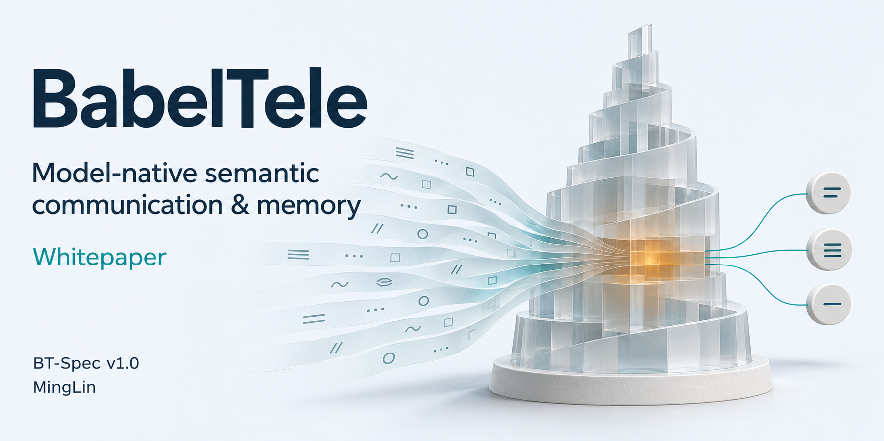

<div align="center">



# 🗼 BabelTele Whitepaper (`BT-Spec v1.0`)
### *A Model-Native High-Density Semantic Communication & Memory System*

**[🇨🇳 简体中文版 (Chinese)](./README.md)** · **[🇬🇧 English Edition](./README_EN.md)** · **[📖 Live Online E-Book](https://minglink.github.io/BabelTele-Whitepaper/)** · **[📥 Download PDF Releases](https://github.com/Minglink/BabelTele-Whitepaper/releases/latest)**

[](./WHITEPAPER_EN.md)
[](https://minglink.github.io/BabelTele-Whitepaper/)
[](https://github.com/Minglink/BabelTele-Whitepaper/releases/latest)
[](https://arxiv.org/abs/2606.19857)
[-181717?style=flat-square&logo=github)](https://github.com/Minglink)
[](./LICENSE)

**"Humanity built MCP and A2A as the transport pipes of the agentic internet; BabelTele defines the silicon-native language flowing inside them."**

</div>

---

## 📖 Overview

Even when **both the sender and the receiver of a message are Large Language Models**—across multi-agent coordination, persistent episodic memory, and long-context RAG—today's AI stacks still force models to communicate in verbose human prose, paying a **60%–75% Anthropocentric Readability Tax** in syntactic padding, monolingual spelling inefficiency, and clause linearization.

**The BabelTele System (`BT-Spec v1.0`)** eliminates human syntactic redundancy in machine-to-machine communication, establishing a weight-agnostic, black-box-compatible, zero-shot cross-model semantic protocol.

### Intuitive Collapse Examples

| Domain | Verbose Human Natural Language | BabelTele Encoding (Zero-Shot LLM Native) | Compression |
| :--- | :--- | :--- | :---: |
| **Science** | *"During photosynthesis, plants take in carbon dioxide and water. The water is oxidized, losing electrons, while the carbon dioxide is reduced, gaining electrons. This transforms them into oxygen and glucose."* | `🌿光合: CO2+H2O ⇨(ox/red)⇨ O2↑ + Glucose. 💧-e⁻, CO2+e⁻.` | **`45 → 11` visual units**<br>*(ASCII BPE mode: 19 tok)* |
| **Strategy** | *"Q3 revenue is projected to rise ~30% YoY; if it lands, the Berlin team ships the mobile app in October."* | `Q3rev📈~30%YoY; ?lands⇒Berlin👥🚀📱@Oct` | **`24 → 9` tokens**<br>*(-62.5%)* |
| **Security** | *"If the JWT header algorithm is set to 'none' or the expiration timestamp is missing, immediately reject the request with HTTP 401 except on public healthcheck endpoints."* | `?JWT.alg=='none' \| !JWT.exp => reject(401) !endpoint:/healthz` | **`33 → 13` tokens**<br>*(-60.6%)* |

---

## 📊 Key Empirical Benchmarks

| Dimension | Verified Result | Benchmark & Experimental Setting |
| :--- | :--- | :--- |
| **Density vs. Fidelity** | Condenses text to **`27.9%`** of original volume while retaining **`99.5%`** downstream QA fidelity | `arXiv:2606.19857` task-agnostic long-document comprehension |
| **Heterogeneous Multi-Agent** | Cuts inter-agent token overhead by **`44.21%`** while retaining **`99.7%`** of baseline task score | DeepResearch Bench (Gemini 3.1 Pro $\leftrightarrow$ GPT-5.4 zero-shot) |
| **Agent Episodic Memory** | Saves **`~51%`** memory tokens at **`96.48%`** relative accuracy (outperforming prose summaries) | LoCoMo multi-session conversational memory benchmark |
| **Context-Window Extension** | Boosts accuracy by **`+10.34%`** over truncation on **`1.65M-token`** code repositories | LongBench v2 Code Repo QA Long on `200K`-window GLM-5.1 (`62.07% → 72.41%`) |

---

## 📚 Complete Whitepaper & Modular Specification

* 📥 **Typeset PDF Releases**:
  * [**Download English Whitepaper PDF (`BabelTele-Whitepaper-v1.0-en.pdf`)**](https://github.com/Minglink/BabelTele-Whitepaper/releases/download/v1.0.0/BabelTele-Whitepaper-v1.0-en.pdf)
  * [**下载中文典藏版白皮书 PDF (`BabelTele-Whitepaper-v1.0-zh.pdf`)**](https://github.com/Minglink/BabelTele-Whitepaper/releases/download/v1.0.0/BabelTele-Whitepaper-v1.0-zh.pdf)
* 🌐 **Interactive Online E-Book**: [**https://minglink.github.io/BabelTele-Whitepaper/**](https://minglink.github.io/BabelTele-Whitepaper/)

| Section | Document | Scope & Highlights |
| :---: | :--- | :--- |
| **Canonical** | **[`WHITEPAPER_EN.md`](./WHITEPAPER_EN.md)** | **Complete Single-Document Whitepaper** (Classic 10-section architectural treatise) |
| **Chapter 01** | **[Manifesto & The Readability Tax](./en/01-manifesto-and-problem.md)** | Biological prose redundancy, MCP/A2A channel limits, and the Babel + 1866 Telegraph metaphor |
| **Chapter 02** | **[Theoretical Foundations & Decoupling](./en/02-theoretical-foundations.md)** | Rate-distortion projection, 13x–20x base-model PPL surge, and the Tripartite Decoupling Principle |
| **Chapter 03** | **[Core Axioms & Canonical Grammar](./en/03-core-axioms-and-grammar.md)** | **`BT-Spec v1.0`**: Three axioms, `tiktoken` BPE paradox proof ($\Delta L_{\text{BPE}} < 0$), and six operator clusters |
| **Chapter 04** | **[Compression Tiers & CoT Dynamics](./en/04-compression-tiers-and-cot.md)** | Space-time CoT trade-off, denoising acceleration, lifecycle cost formula, and `BT-L0`–`BT-L3` tiers |
| **Chapter 05** | **[Agentic Stack & Merkle Memory Tree](./en/05-agentic-protocol-stack.md)** | 5-layer MCP/A2A/BabelTele envelope spec, **SMFT hierarchical memory folding**, and 1.65M repo scaling |
| **Chapter 06** | **[Cross-Model Consensus & Audit Gateway](./en/06-cross-model-consensus-and-audit.md)** | 19-model zero-shot portability laws, dense vs. MoE scaling, and **Tier 1–3 deterministic safety auditing** |
| **Chapter 07** | **[Canonical Compiler & Decoder Prompts](./en/07-canonical-instruction-set.md)** | Copy-paste production prompts (`BT-Core`, `BT-Memory`, `BT-Skeleton`, `BT-Zero`, `BT-Decoder`) + `BT-P1`–`P13` |
| **Chapter 08** | **[Genealogy, Errata & Ecosystem](./en/08-genealogy-and-ecosystem.md)** | Paradigm comparison, viral OCR & GibberLink errata, 6 GitHub tools, 3 HF datasets, and 7-step eval protocol |

---

## ⚡ 30-Second Quick Start

Paste the **`BT-Core` Compiler Prompt** into any frontier model (GPT-5.4, Claude, Gemini, DeepSeek, Qwen) followed by your document:

```markdown
Your task: compress verbose human text into a minimal token sequence. The audience is not human, but another equally intelligent LLM.

Core Directive:
1. Omnilingual: Ignore single-language grammar; traverse all human languages (Chinese, English, German compounds, Japanese kanji, Latin roots, etc.) and pick the highest information-density words for the target tokenizer.
2. Symbolic Collapse: Replace conjunctions, prepositions, emotions, and verbose clauses with compact mathematical/logical operators (=>, ->, &, |, !, ∈, !=) and high-frequency symbols.
3. Universality: Any LLM must fully understand the compressed output zero-shot without an external codebook.
4. Lossless: Retain all core semantics, entity bindings, exact quantities, units, and details verbatim without rounding or hallucination.

Directly output the compressed text without any preface. Compress the content below:
[PASTE YOUR LONG CONTEXT OR AGENT MESSAGE HERE]
```

---

## ❓ Frequently Asked Questions (FAQ)

<details open>
<summary><b>Q1: What is BabelTele ("巴别语" / "巴别塔电报" / Babel-Telegraph)?</b></summary>

**BabelTele** (Chinese: **巴别语** or **巴别塔电报**) is a paradigm of **model-native, high-density discrete textual representations** optimized for LLM-to-LLM consumption rather than human readability. Originally discovered empirically in *Large Language Models Do Not Always Need Readable Language* (`arXiv:2606.19857`), it is formalized in this whitepaper as **The BabelTele System (`BT-Spec v1.0`)**—comprising three formal axioms, six symbolic operator clusters, four compression tiers (`BT-L0`–`BT-L3`), the Semantic Merkle Folding Tree (SMFT), and a Three-Tier Deterministic Safety Audit Gateway.
</details>

<details>
<summary><b>Q2: Does BabelTele replace MCP (Model Context Protocol) or A2A (Agent-to-Agent Protocol)?</b></summary>

No—they operate at complementary layers of the agentic stack. MCP standardizes vertical tool/context binding and A2A standardizes horizontal agent discovery, authentication, and task lifecycles (the "HTTP/RPC transport channels"). **BabelTele (`content_encoding: "babeltele/1.0"`) operates at Layer 4 as the high-density semantic payload**, cutting context token overhead by 40%–75% inside MCP tool returns and A2A messages without altering outer routing envelopes.
</details>

<details>
<summary><b>Q3: Do emojis, math symbols, and CJK characters always use fewer BPE tokens than English words?</b></summary>

**No—this is the Naive Symbol Illusion.** Direct `tiktoken` (`cl100k_base` / `o200k_base`) measurements prove that swapping 1-token words like `water` or `and` into `💧` or `∧` inflates count to `2` tokens via UTF-8 byte splitting. `BT-Spec v1.0` enforces the **Net BPE Savings Inequality ($\Delta L_{\text{BPE}} < 0$)**: true 3x–4x compression comes from **clause-level syntactic collapse** paired with single-token ASCII operators (`->`, `=>`, `&`, `?`, `!`, `@`) and tokenizer-aware omnilingual selection.
</details>

<details>
<summary><b>Q4: How do humans audit safety and prevent numeric hallucinations if inter-agent text is unreadable?</b></summary>

`BT-Spec v1.0` mandates a **Three-Tier Audit Gateway**: **Tier-1** runs `<2ms` deterministic regex checks verifying bit-exact preservation of all numbers, units, formulas, and identifiers; **Tier-2** deploys lightweight semantic guardrail LLMs that inspect BabelTele payloads zero-shot for prompt injection; **Tier-3** provides an on-demand lossless Sidecar Decoder (`BT-Decoder`) in human observability dashboards.
</details>

---

## 🤖 Machine-Readable Endpoints for AI Agents & Crawlers

* **[`llms.txt`](https://minglink.github.io/BabelTele-Whitepaper/llms.txt)** — Structured AI navigation index (`llmstxt.org` standard)
* **[`llms-full.txt`](https://minglink.github.io/BabelTele-Whitepaper/llms-full.txt)** — Single-file complete bilingual specification & prompt corpus for RAG ingestion
* **[`llms-bt.txt`](https://minglink.github.io/BabelTele-Whitepaper/llms-bt.txt)** — Self-bootstrapped `BT-L2` native BabelTele digest of this entire whitepaper
* **[`sitemap.xml`](https://minglink.github.io/BabelTele-Whitepaper/sitemap.xml)** · **[`CITATION.cff`](./CITATION.cff)** — Pre-rendered static HTML sitemap & academic citation metadata

---

## 📜 Attribution & Citation

```bibtex
@article{zhu2026babeltele,
  title   = {Large Language Models Do Not Always Need Readable Language},
  author  = {Zhu, Jiayi and Peng, Haoxuan and Wang, Junxi and Ke, Liang and Zhang, Chen and Zhang, Linfeng},
  journal = {arXiv preprint arXiv:2606.19857},
  year    = {2026}
}

@misc{minglin2026babeltelespec,
  title        = {BabelTele Whitepaper: A Model-Native High-Density Semantic Communication and Memory System (BT-Spec v1.0)},
  author       = {MingLin},
  year         = {2026},
  howpublished = {\url{https://github.com/Minglink/BabelTele-Whitepaper}}
}
```

---

<div align="center">
<sub>Crafted & Systematized by <a href="https://github.com/Minglink"><b>MingLin (@Minglink)</b></a> · Licensed under <a href="https://github.com/Minglink/BabelTele-Whitepaper/blob/main/LICENSE">CC BY 4.0 & MIT</a></sub>
</div>
