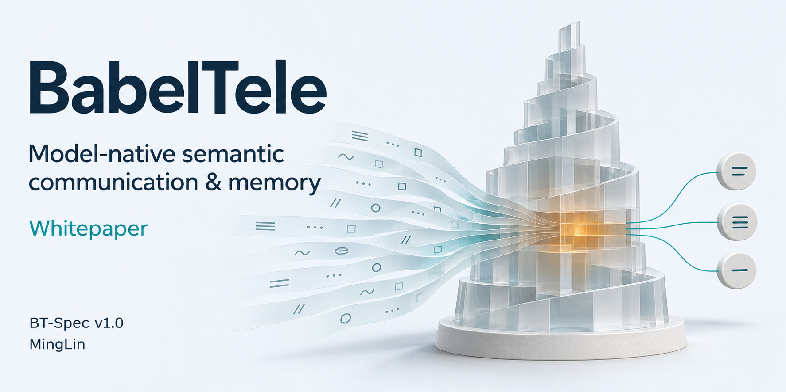

<div align="center">



# BabelTele: A Model-Native High-Density Semantic Communication and Memory System

**MingLin** (`@Minglink`)  
*November 2026 · Protocol Specification BT-Spec v1.0*  
https://github.com/Minglink/BabelTele-Whitepaper

[🇨🇳 简体中文版 (Chinese Edition)](./WHITEPAPER.md) · [📖 Online E-Book](https://minglink.github.io/BabelTele-Whitepaper/#/en/WHITEPAPER_EN) · [📥 Download PDF](https://github.com/Minglink/BabelTele-Whitepaper/releases/download/v1.0.0/BabelTele-Whitepaper-v1.0-en.pdf)

</div>

---

## Abstract

Purely silicon-to-silicon communication should allow large language models (LLMs) to exchange high-density semantics directly without being bottlenecked by the intermediary constraint of human readability. Contemporary prompt engineering, agentic memory architectures, and multi-agent transport standards (such as MCP and A2A) successfully standardize tool binding and session routing, yet their internal payloads remain trapped in verbose natural-language prose evolved for human biological constraints. Natural language carries substantial syntactic padding designed for linear auditory processing and social pragmatics, imposing severe compute waste, context-window exhaustion, and attention degradation across long-horizon and multi-agent workflows. Synthesizing recent empirical breakthroughs in model-native representations—most notably the *BabelTele* phenomenon introduced by Zhu et al. (2026)—with context-compression theory and systems engineering, this whitepaper formally establishes **The BabelTele System (`BT-Spec v1.0`)**. By relaxing the human-readability prior under three foundational axioms—**Omnilingual Token Minimization, Relational Graph Collapse, and Zero-Codebook Self-Recoverability**—BabelTele defines a discrete textual protocol that requires zero weight modifications, operates over pure black-box APIs, and achieves zero-shot cross-model comprehension across heterogeneous model families. We further introduce **four standardized compression tiers (`BT-L0`–`BT-L3`)** governed by Chain-of-Thought (CoT) cognitive dynamics, a **Semantic Merkle Folding Tree (SMFT)** for reclaiming long-horizon context space, and a **Three-Tier Deterministic Fidelity & Safety Audit Gateway** that guarantees exact numeric invariance alongside full human regulatory observability.

---

## 1. Introduction: The Anthropocentric Readability Tax

Modern AI software stacks are built overwhelmingly upon human-readable natural language interfaces. When the intended reader is a human user, complete grammatical syntax, articles, prepositions, discourse transitions, and polite framing are indispensable. However, when **both the sender and the receiver are instruction-tuned large language models**—as in multi-agent state synchronization, retrieval-augmented generation (RAG) chunk injection, or persistent episodic memory recall—human legibility transforms from a communication bridge into a costly **Anthropocentric Readability Tax**.

The industry has recently standardized **MCP (Model Context Protocol)** for vertical model-to-tool integration and **A2A (Agent-to-Agent Protocol)** for horizontal inter-agent orchestration. Yet both protocols operate strictly as **transport and signaling channels**—analogous to HTTP and JSON-RPC—without defining a model-native **semantic payload language**. Conversely, academic proposals for continuous latent-space communication (such as Gist Tokens, AutoCompressors, Activation Beacons, and Latent Collaboration) require white-box hidden-state access and model-specific fine-tuning, rendering them incompatible with black-box commercial APIs and heterogeneous model ecosystems (e.g., GPT, Claude, Gemini, DeepSeek, and Qwen).

What agentic infrastructure requires is an intermediate representation that **combines the universal black-box compatibility of discrete text with an information density approaching latent space**—stripping human grammatical redundancy during transmission, enabling zero-shot consumption across heterogeneous LLMs, and preserving deterministic auditability on demand. This system is **BabelTele**.

---

## 2. Theoretical Formulation & The Tripartite Decoupling Principle

Given a source document $x \in \mathcal{V}^*$, a compressor model $C$ projects $x$ into a compact discrete sequence $z = C(x)$ to be consumed by a downstream reader model $R$ under arbitrary task queries $q$. Removing the traditional human-readability constraint $H_{\text{human}}(z) \ge \tau$, BabelTele formulates compilation as a **Rate-Distortion Semantic Projection**:

$$z^* = \arg\min_{z \in \mathcal{V}^*} \Big[ L_{\text{tok}}(z) + \beta \cdot L_{\text{CoT}}(R, z) \Big] \quad \text{s.t.} \quad \mathcal{F}_{\text{sem}}(R; z, x) \ge 1 - \epsilon$$

where $L_{\text{tok}}(z)$ denotes the input token length under the target tokenizer, $L_{\text{CoT}}(R, z)$ captures the reader-side reasoning Chain-of-Thought token overhead, and $\mathcal{F}_{\text{sem}}$ measures downstream task fidelity.

Controlled empirical diagnostics (Zhu et al., 2026) establish the **Tripartite Decoupling Principle**:
1. **Low Human Surface Readability**: Under Dale-Chall diagnostics, BabelTele surges to a score of `16.70` (`80.19%` difficult-word ratio), causing human university readers to suffer sharp drops in QA accuracy and elevated cognitive difficulty.
2. **Low Natural-Language Typicality**: Evaluated across base models including Llama-3-8B, Qwen2/3, DeepSeek-V4-Pro, Kimi K2.6, and GLM-5.1, BabelTele exhibits **1,320% to 2,061% higher Perplexity (PPL)** than original prose, proving it lies far outside ordinary natural-language distributions.
3. **High Model-Side Semantic Recoverability**: Despite extreme distributional atypicality, instruction-tuned LLMs retain up to **99.5% semantic fidelity** when text volume is condensed to **27.9%** of its original length. Because multilingual pretraining aligns cross-lingual synonyms onto shared high-dimensional manifolds and code pretraining equips models with symbolic AST parsing circuits, LLMs decode dense relational graphs directly without human syntax.

---

## 3. The Three Fundamental Axioms

Rather than prescribing a rigid artificial vocabulary, `BT-Spec v1.0` defines a generative representational space governed by three axioms:

* **Axiom I: Omnilingual Token Minimization**  
  Break single-language grammatical boundaries to traverse Chinese characters, English terms, Japanese kanji, German compounds, Latin roots, and scientific notation—selecting the unambiguous lexical unit with minimal subword token cost under the **target tokenizer**. Critically, `BT-Spec v1.0` enforces the **Net BPE Savings Inequality ($\Delta L_{\text{BPE}} < 0$)**: empirical `tiktoken` (`cl100k_base` / `o200k_base`) measurements reveal that naively replacing 1-token English words (`water`, `and`, `because`) with multi-byte Unicode/Emoji glyphs (`💧`, `∧`, `∵`) actually inflates BPE count to `2` tokens via byte fallback. True compression arises from **clause-level syntactic collapse** paired with single-token ASCII operators (`->`, `=>`, `&`, `?`, `!`, `@`).
* **Axiom II: Relational Graph Collapse**  
  Eliminate linear subject-verb-object scaffolding, auxiliary verbs, and subordinate conjunctions, folding entities, attributes, causal chains, and conditional boundaries directly into explicit node-operator-attribute graphs.
* **Axiom III: Zero-Codebook Self-Recoverability**  
  Forbid stateful external private codebooks (inline first-use macro bindings `@[Abbr=Full]` within the same context are permitted). Enforce **Hard-Data Invariance**: all exact numbers, units, formulas, version identifiers, and anti-hallucination placeholders (`BIBREF`) must be preserved verbatim without rounding; missing source facts must be marked explicitly as `?` or `NULL`.

---

## 4. Formal Lexicon & Six Symbolic Operator Clusters

`BT-Spec v1.0` standardizes six operator clusters aligned with LLM code and mathematical pretraining priors:

1. **Causality & Flow**: `=>` / `⇨` (entailment/causation), `<=>` (equivalence), `->` (sequential pipeline), `<-` / `∵` (provenance).
2. **Logic & Boundaries**: `&` / `∧` (conjunction), `|` / `∨` (disjunction), `!` / `¬` (negation), `?cond => act` (conditional branch), `!obj:detail` (exception/exemption).
3. **Sets & Spatiotemporal Anchors**: `∈` / `∉` (membership), `∀` / `∃` (quantifiers), `@` (location/time/scope binding), `#Topic` (module header), `@[X=Full]` (inline macro).
4. **Entity Binding & Flattening**: `@Ent(K=V)` (key-value binding), `[A,B,C]` (parallel array flattening), `Parent:{c1,c2}` (hierarchy), `$param:V(unit)` (exact parameter).
5. **Comparison & Dynamics**: `A <> B : res` (comparative matrix), `⇎` (cross-standard conflict), `↑` / `📈` (increase/gas evolution), `↓` / `📉` (decrease).
6. **Epistemic & Anti-Hallucination**: `?` / `NULL` (unspecified in source), `~` / `≈` (approximate source value), verbatim identifier lock.

**Canonical Micro-Example** (45-token English prose collapsed into dense BabelTele):
```text
Original : During photosynthesis, plants take in carbon dioxide and water. The water is oxidized, losing electrons, while the carbon dioxide is reduced, gaining electrons. This transforms them into oxygen and glucose.
BabelTele: 🌿光合: CO2+H2O ⇨(ox/red)⇨ O2↑ + Glucose. 💧-e⁻, CO2+e⁻.
```

---

## 5. Compression Dynamics & Four Standardized Tiers

Across 116 retention-sweep experiments spanning 4,714 QA instances on QuALITY and MeetingBank, BabelTele introduces no intrinsic surface decoding tax compared to natural-language summaries or LLMLingua-2. However, pushing retention below `10%` triggers a universal space-time trade-off where sparse evidence inflates reader CoT tokens; conversely, mild compression (`40%–60%` retention) yields **denoising acceleration**, reducing CoT tokens below the uncompressed baseline (`< 1.0x`). Accordingly, `BT-Spec v1.0` defines four operational tiers:

* **`BT-L0` (Telegraphic Prose, `55%–70%` retention)**: Monolingual telegraphese retaining rapid human skimmability.
* **`BT-L1` (Structured Hybrid, `40%–55%` retention)**: Key-value structuring + basic causal arrows; triggers CoT denoising acceleration for short-session working memory.
* **`BT-L2` (Canonical BabelTele, `25%–40%` retention — Recommended Default)**: Full omnilingual selection + six operator clusters; balances ~70% token reduction with peak cross-model fidelity.
* **`BT-L3` (Extreme / ASCII Skeleton, `5%–25%` retention)**: Pure single-character ASCII skeleton (`BT-L3-ASCII`) engineered to fit multi-million-token codebases (e.g., `1.65M tokens`) into `200K–256K` physical context windows (`+10.34` percentage points over truncation on GLM-5.1).

---

## 6. The Five-Layer Agentic Protocol Stack

BabelTele does not replace MCP or A2A; rather, it supplies the missing **Model-Native Semantic Payload Layer** atop existing agentic transport protocols:

```text
[L5 Human Presentation Layer]  Natural-language rendering (decoded strictly on demand for human UX/approval)
[L4 Semantic Payload Layer]    BabelTele (content_encoding: "babeltele/1.0", bt_tier: "BT-L2")
[L3 Agent Orchestration Layer] A2A Protocol (Agent Cards, horizontal task delegation & lifecycle)
[L2 Tool & Context Bus Layer]  MCP Protocol (vertical filesystem, database & API context binding)
[L1 Transport & Framing Layer] HTTP/2 · SSE · WebSocket · JSON-RPC 2.0
```

In heterogeneous multi-agent collaboration on DeepResearch Bench (Gemini 3.1 Pro $\leftrightarrow$ GPT-5.4), enabling L4 BabelTele payloads cuts inter-agent token consumption by **44.21%** while retaining **99.7%** of baseline task performance.

---

## 7. Reclaiming Context Space: Semantic Merkle Folding Tree (SMFT)

Inspired by Bitcoin's Merkle Tree disk-space reclamation (Nakamoto, 2008, §7), BabelTele resolves unbounded episodic memory growth in long-running agents via the **Semantic Merkle Folding Tree (SMFT)**:
1. **Hot-Cold Separation**: Recent active turns remain in raw natural language; overflowing history segments are compiled into self-contained `[T1] {h1}` BabelTele checkpoints while raw transcripts are archived to cold storage with cryptographic hash pointers.
2. **Hierarchical Tree Merging**: As `T1` blocks accumulate toward context budget limits, older sibling blocks merge recursively into `[T2] {h2}` and `[T3]` rolled summary blocks—preserving high resolution for recent events and topological density for distant history.
3. **Lossless Pointer Dereferencing**: Because exact entities, metrics, and block IDs remain intact, an agent requiring verbatim legal or code inspection can dereference `decompress(block_id)` on demand.

---

## 8. Cross-Model Portability & Asymmetric Decoding

Cross-model transfer matrices across 19 proprietary and open-weight models demonstrate systematic zero-shot portability governed by two architectural laws:
1. **Balanced Upstream Compilers Maximize Portability**: Models with balanced `75%–85%` compression ratios and strong multilingual-symbolic alignment (notably GPT-5.4 and Claude Sonnet 4.6) produce the most universally decodable representations across heterogeneous readers.
2. **Active Parameter Capacity Governs Decoding**: Reader robustness does not scale monotonically with total parameter count; dense active capacity (`Qwen3.5-27B` retaining `88.26%` performance vs. sparse MoE `Qwen3.5-397B-A17B` at `85.07%`) determines resilience under ultra-dense (`>95%`) compression.

---

## 9. Three-Tier Deterministic Fidelity & Safety Audit Gateway

To eliminate silent numeric drift and regulatory opacity in safety-critical deployments, `BT-Spec v1.0` mandates a **Three-Tier Audit Gateway**:
* **Tier-1 Deterministic Literal Anchor Check (`< 2ms` standard-library check)**: Extracts all numbers, units, formulas, versions, and identifiers from source $x$ and verifies 100% bit-exact preservation in $z$ prior to dispatch.
* **Tier-2 Cross-Model Blind Verification & Semantic Guardrails**: High-stakes knowledge commits undergo blind contract verification by an independent model family, while MCP/A2A gateways run lightweight LLM semantic guardrails capable of inspecting BabelTele payloads directly for prompt injection or policy violations.
* **Tier-3 Human-in-the-Loop Sidecar Decoder**: Observability dashboards invoke a read-only lossless decoder on hover or alert—delivering **machine-speed telegraphic efficiency internally, and 100% human-auditable transparency on demand**.

---

## 10. Evolution Roadmap & Conclusion

We have presented a black-box-compatible, weight-agnostic system for model-native semantic communication and memory. Looking forward, the BabelTele ecosystem advances along two trajectories: (1) full-lifecycle cost routing governed by amortization accounting across compilation, $N$-time reuse, and CoT overhead; and (2) transitioning from prompt-elicited compression toward **end-to-end Reinforcement Learning (RL) native emergence**, internalizing BPE rate-distortion optimality directly into post-training rewards.

Human natural language is one evolutionary surface form optimized for biological channels. When silicon models serve as both producer and consumer of context, decoupling **model-side semantic recoverability** from **human surface readability** unlocks a new efficiency frontier—establishing a verifiable, high-density linguistic foundation for autonomous multi-agent intelligence.

---

## References

1. Jiayi Zhu, Haoxuan Peng, Junxi Wang, Liang Ke, Chen Zhang, and Linfeng Zhang. *"Large Language Models Do Not Always Need Readable Language."* arXiv:2606.19857 [cs.CL], June 2026.
2. Claude E. Shannon. *"A Mathematical Theory of Communication."* Bell System Technical Journal, 27(3):379–423, 1948.
3. Satoshi Nakamoto. *"Bitcoin: A Peer-to-Peer Electronic Cash System."* bitcoin.org, October 2008.
4. Grégoire Delétang et al. *"Language Modeling Is Compression."* ICLR, 2024.
5. Zhuoshi Pan et al. *"LLMLingua-2: Data Distillation for Efficient and Faithful Task-Agnostic Prompt Compression."* Findings of ACL, 2024.
6. Jesse Mu, Xiang Li, and Noah Goodman. *"Learning to Compress Prompts with Gist Tokens."* NeurIPS, 2023.
7. Charles Packer et al. *"MemGPT: Towards LLMs as Operating Systems."* arXiv:2310.08560, 2023.
8. Nelson F. Liu et al. *"Lost in the Middle: How Language Models Use Long Contexts."* TACL, 12:157–173, 2024.
