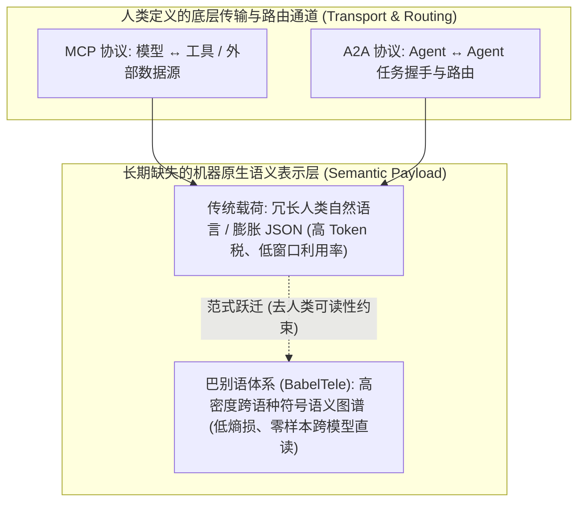

# 第一章：人类可读性税与巴别塔隐喻
**Chapter 01 — The Anthropocentric Readability Tax & The Babel Metaphor**

> [返回门户首页 (README)](../README.md) · [阅读单文件完整版白皮书 (WHITEPAPER)](../WHITEPAPER.md) · [下一章：信息论基础与解耦定理 →](./02-theoretical-foundations.md)

---

## 1.1 碳基语言的演化遗产与硅基系统的错配

自大语言模型（LLM）展现出上下文学习（In-Context Learning）与指令遵循能力以来，整个人工智能工程体系默认建立在一个未经审视的前提之上：**知识的存储、指令的下达、智能体间的状态同步以及外部工具的上下文返回，全部以人类可读的自然语言作为标准媒介。**

然而，人类的自然语言并非为高带宽、低熵损耗的信息传输而演化出来的纯粹编码系统；它是碳基生物在漫长演化中为适应**线性听觉通道、有限工作记忆（$7 \pm 2$ 组块）以及社会协作礼仪**而形成的折中产物：

1. **语法缓冲冗余（Syntactic Padding）**：冠词、介词、助动词、时态变位与从句引导词本身几乎不携带独立事实增量，其主要功能是降低人类大脑实时线性解析的认知负荷。
2. **线性展开代价（Graph Linearization Cost）**：客观世界中的实体、属性与因果网络本质上是高维有向图（Directed Semantic Graph），但人类口语与书面语必须耗费大量连接词将其强行压平为一维字符流。
3. **单语种词表低效（Monolingual Sub-optimality）**：单一自然语言受限于历史构词法，对不同领域概念的编码长度极不均衡（例如英文 `photosynthesis` 需跨越长词根拼写，而中文 `光合` 仅需两个高密度汉字；反之部分中文复合词又可能引入字面组合歧义，不如拉丁学名或科学记法精确）。
4. **社交与语用噪音（Pragmatic Overhead）**：寒暄、语气缓和词、过渡句与重复强调在人际沟通中维系信任，但在机器对机器（M2M）推理中纯属无效算力消耗。

当通信双方的**发送者（Sender）与接收者（Receiver）均为具备全局注意力机制（Self-Attention）与多语言对齐潜空间的硅基大模型**时，继续强迫它们使用完整的人类自然语言交谈，无异于要求两台现代服务器通过模拟人类朗读摩尔斯电码来交换数据库快照。我们将这种因迁就人类阅读习惯而额外付出的算力、延迟与上下文窗口损耗，定义为 **“人类可读性税”（The Anthropocentric Readability Tax）**。

---

## 1.2 通道已通，语言未立：MCP 与 A2A 之后的下一块拼图

在迈向多智能体协作网络（Multi-Agent Networks）的进程中，工业界已经率先完成了“通信管道”的标准化：

* **MCP（Model Context Protocol，模型上下文协议）**：解决了**纵向连接**问题——规范了大模型如何挂载外部数据源、本地文件与工具接口。
* **A2A（Agent-to-Agent Protocol，智能体间协议）**：解决了**横向路由**问题——规范了异构智能体之间的身份发现（Agent Card）、任务委派与生命周期同步。

MCP 与 A2A 如同互联网早期的 **HTTP 与 RPC 信令通道**：它们打通了智能体世界的孤岛，规定了“信封怎么写、邮路怎么走”，却**没有重新定义信封里面的“语言”**。目前流淌在 MCP 上下文管道与 A2A 消息体内部的，依然是大段冗长的人类自然语言文本。

随着长程自主智能体（Long-Horizon Autonomous Agents）的普及，机器与机器之间的交互频次正在呈指数级超越人机交互：
* 一个深度研究多智能体集群完成单次复杂课题，内部可能产生数百轮状态广播；
* 一个持久化数字助手运行数月，其会话历史与环境观察日志可轻易突破百万（1M+）Token，引发“迷失在中间”（Lost-in-the-Middle）注意力退化与高昂的 KV Cache 显存开销。

在这一背景下，**将“面向机器消费的内部中间表示（IR）”与“面向人类阅读的终端展示语言”彻底解耦**，成为智能体基础设施演进的必然方向。

---

## 1.3 “巴别塔电报”（BabelTele）的双重文明隐喻

2026 年 6 月，由上海交通大学朱家毅、张林峰教授团队联合悉尼大学、合肥工业大学、西安交通大学、南京大学研究者发表的开创性研究 *Large Language Models Do Not Always Need Readable Language*（`arXiv:2606.19857`），首次通过严谨的大规模实证探测命名并验证了 **BabelTele（巴别塔电报 / 巴别语）** 现象。

这一命名蕴含着跨越宗教神话与通信工程史的双重深刻隐喻：

| 隐喻维度 | 历史原型 | 在硅基智能时代的反转与重生 |
| :--- | :--- | :--- |
| **Babel（巴别塔）** | 《圣经·创世记》中人类因语言被打乱而彼此隔绝、协作瓦解，形成数千种互斥的自然语言孤岛。 | 多语言预训练大模型在同一个高维流形中对齐了全人类语系。AI 不再被锁死在单一语种内，而是**逆向消融巴别塔隔阂**，跨中、英、德、日、拉丁词根与科学符号自由拾取最高密度的概念入口。 |
| **Tele（电报体 Telegraphese）** | 1866 年跨大西洋海底电报开通后，高昂的按词计费倒逼人类砍掉冠词与寒暄（如将 *"I am well and hope you are too"* 压为 *"WELL HOPE SAME"*，中文电报作 *“安好勿念”*、文言成语亦然）。 | 在算力与上下文窗口受限的信道中，大模型将电报式的“惜字如金”推向极致——彻底剥离人类线性语法，直接以多语种词元与逻辑算子编织高密度语义网络。 |

---

## 1.4 为什么我们需要一部“比特币式”的巴别语体系白皮书？

在中本聪（Satoshi Nakamoto）于 2008 年发布《比特币：一种点对点电子现金系统》之前，非对称加密、Merkle 树（1979）、时间戳服务器（1991）、Hashcash 工作量证明（1997）与 b-money（1998）等底层组件早已散落于学术文献之中。比特币白皮书的伟大之处，在于将这些分散的密码学发现**熔铸为一套逻辑自洽、可工程落地、具备清晰激励与验证闭环的完整系统架构**。

今天，“巴别语（BabelTele）”正处于相似的历史节点：
* **学术界**（如 `arXiv:2606.19857`、LLMLingua、Gist Tokens、Latent Collaboration 等）已经证明了可读性与模型可恢复性可以解耦，并给出了十余种探索性提示词探针；
* **开源社区**已经自发涌现出 Rust 离线分词过滤器、LangChain 压缩中间件、多级对话折叠插件以及面向代码智能体的 `PreCompact` 钩子；
* **工程实践与安全治理**却仍缺乏统一的体系标准：何时该用哪种语法骨架？如何防止罕见符号在 BPE 分词器中反向膨胀？如何在压缩 70% 体积的同时避免推理思维链（CoT）报复性暴涨？最关键的是——**当 AI 开始使用人类肉眼不可读的“天书”高速通信时，人类如何建立确定性的保真校验与安全审计防线？**

本白皮书旨在**融汇目前全网所有关于巴别语与模型原生压缩的前沿研究与工程实践**，在完全兼容纯黑盒 API、无需修改模型权重的前提下，正式确立 **巴别语体系（The BabelTele System, BT-Spec v1.0）**——一套涵盖**信息论基础、三大公理、标准语法算子、四级压缩档位、MCP/A2A 协议栈集成、语义默克尔记忆折叠树与三层安全审计网关**的完整技术标准。

---

> **下一章预告**：在建立语法规范之前，我们首先从香农信息论与实验数据出发，严格证明为什么一段困惑度（PPL）暴涨近 20 倍、人类难以阅读的文本，对大模型而言却能保持 99.5% 的无损语义。请继续阅读 [第二章：信息论基础与解耦定理 →](./02-theoretical-foundations.md)。
