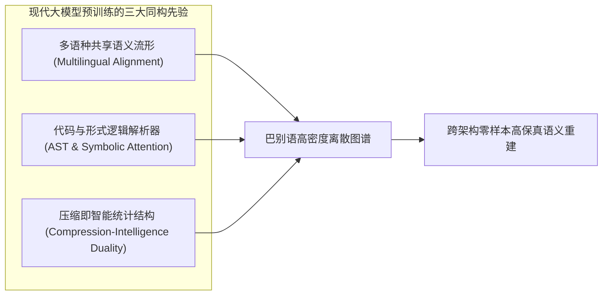

# 第二章：信息论基础与解耦定理
**Chapter 02 — Information-Theoretical Foundations & The Decoupling Principle**

> [← 上一章：人类可读性税与巴别塔隐喻](./01-manifesto-and-problem.md) · [返回门户首页 (README)](../README.md) · [下一章：巴别语三大公理与标准语法算子规范 →](./03-core-axioms-and-grammar.md)

---

## 2.1 可读性放宽的语义投影（Readability-Relaxed Semantic Projection）

在经典的上下文压缩框架中，给定源文档 $x \in \mathcal{V}^*$（长度为 $L(x)$ 个 Token），压缩器 $C$ 生成一个更短的离散文本序列 $z = C(x)$（满足 $L(z) \ll L(x)$），随后交由阅读器模型 $R$ 执行下游任务 $T$（如问答、推理、规划或代码分析）。

传统摘要与提示词压缩方法（如抽取式过滤 Selective Context、LLMLingua 或抽象式重写 RECOMP）隐式地施加了一个强先验约束——**要求压缩产物 $z$ 必须留在常规自然语言分布 $P_{\text{NL}}$ 的高概率流形内**，以便人类能够顺畅阅读：

$$\min_{z} \; L(z) \quad \text{s.t.} \quad \mathcal{D}_{\text{sem}}\big(R(x, q),\, R(z, q)\big) \le \epsilon \;\;\wedge\;\; H_{\text{human}}(z) \ge \tau_{\text{read}}$$

其中：
* $\mathcal{D}_{\text{sem}}$ 度量阅读模型 $R$ 基于压缩文本 $z$ 与原始文本 $x$ 在任意未知下游查询 $q$ 上的语义响应偏差；
* $H_{\text{human}}(z) \ge \tau_{\text{read}}$ 代表人类可读性与单语种语法合法性约束。

**巴别语体系的核心理论突破，在于彻底移除冗余约束 $H_{\text{human}}(z) \ge \tau_{\text{read}}$**。当且仅当接收方 $R$ 是经过大规模多语种、代码与数学符号指令微调的大语言模型时，优化目标简化为纯粹的**率失真语义投影（Rate-Distortion Semantic Projection）**：

$$z^* = \arg\min_{z \in \mathcal{V}^*} \Big[ L_{\text{tok}}(z) + \beta \cdot L_{\text{CoT}}(R, z) \Big] \quad \text{s.t.} \quad \mathcal{F}_{\text{sem}}(R; z, x) \ge 1 - \epsilon$$

请注意上式中引入的关键二阶项 $\beta \cdot L_{\text{CoT}}(R, z)$：**真正的系统最优并非单纯追求输入序列 $L_{\text{tok}}(z)$ 趋近于零，而是使“输入上下文开销 + 阅读端推理思维链（CoT）解码开销”的总和最小化**（详见第四章动力学分析）。

---

## 2.2 三元解耦实证定理（The Tripartite Decoupling Principle）

长期以来，自然语言处理界存在一种直觉误区：认为一段文本如果偏离基座语言模型的自然语言概率分布（表现为极高的困惑度 Perplexity），或者人类肉眼无法读懂，那么大模型也必然将其视为无意义乱码（Gibberish）。

综合 `arXiv:2606.19857` 在 QuALITY 长文档阅读理解基准与有偿人类受试者问卷上的对照实验，巴别语体系确立了如下**三元解耦定理**：

> [!IMPORTANT]
> **三元解耦原理（Decoupling of Readability, Typicality, and Recoverability）**
> 在现代指令微调大语言模型的离散输入空间中，以下三个属性并非绑定共生，而是可以显著分离的独立维度：
> 1. **人类表面可读性（Human Surface Readability）**
> 2. **自然语言分布典型性（Natural-Language Distributional Typicality / Low PPL）**
> 3. **模型侧语义可恢复性（Model-Side Semantic Recoverability）**

### 实证证据一：表面可读性断崖式跌落
采用经典的 **Dale-Chall 可读性指数**（分数越高代表文本越晦涩难读，常规大学毕业生阅读水平约为 `9.0–9.9`）对原文、自然语言摘要与巴别语编码进行对比诊断：

| 文本形态 | 样本组数 | Dale-Chall 评分（↑ 越难读） | 生僻/非常规词元占比（Difficult Words Ratio） |
| :--- | :---: | :---: | :---: |
| **原始自然语言长文（Original）** | 10 | `10.28` | `35.97%` |
| **人类可读自然语言摘要（Summary）** | 10 | `13.51` | `56.34%` |
| **巴别语编码（BabelTele）** | 10 | **`16.70`** | **`80.19%`** |

高达 `80.19%` 的非常规词元占比与 `16.70` 的极端评分表明，巴别语已经完全脱离了传统自然语言散文的范畴。

### 实证证据二：基座语言模型困惑度（PPL）暴涨 13～20 倍
将三种文本输入多款主流开源与闭源基座模型计算序列困惑度（Perplexity, PPL）。自然语言摘要的 PPL 与原文几乎处于同一数量级（仅波动 `-6.2%` 至 `+17.5%`），而巴别语的 PPL 出现了**跨数量级跃升**：

| 评估基座模型 | 原文 PPL | 自然语言摘要 PPL（相对变化） | 巴别语 PPL（相对变化） |
| :--- | :---: | :---: | :---: |
| **Llama-3-8B** | `9.63` | `11.32` (+17.5%) | **`176.60` (+1,733.9%)** |
| **Qwen2-7B** | `10.93` | `12.44` (+13.8%) | **`236.23` (+2,061.1%)** |
| **Qwen2.5-7B** | `10.43` | `11.56` (+10.8%) | **`209.30` (+1,906.7%)** |
| **Qwen3-8B** | `14.94` | `15.22` (+1.9%) | **`301.22` (+1,916.2%)** |
| **Qwen3-32B** | `11.80` | `11.07` (-6.2%) | **`220.76` (+1,770.8%)** |
| **Kimi K2.6** | `6.93` | `7.76` (+11.9%) | **`127.96` (+1,746.5%)** |
| **DeepSeek V4 Pro** | `7.67` | `7.75` (+1.1%) | **`108.95` (+1,320.5%)** |
| **GLM 5.1** | `7.89` | `8.40` (+6.5%) | **`148.23` (+1,778.7%)** |

这一数据揭示了一个极其深刻的机理：**低序列生成似然（High PPL）只代表模型在预训练语料中很少见到这种表面排版，绝不等同于模型无法从中提取语义。**

### 实证证据三：人类受试者失灵 vs. 大模型无损解码
在针对高校学生的受控有偿问卷测试中，人类读者面对巴别语文本时问答准确率显著下滑、阅读耗时与主观认知负荷剧增；然而同一批巴别语文本输入给 **Gemini 3.1 Pro** 等前沿指令模型时，即使文本体积被浓缩至原长的 **27.9%**，模型依然保持了高达 **99.5% 的下游语义保真度（Semantic Fidelity）**。

---

## 2.3 潜空间对齐假说：为什么大模型能无师自通读懂“天书”？

为什么未经任何专门微调（Zero-shot）的不同家族大模型（GPT、Claude、Gemini、DeepSeek、Qwen、GLM、Kimi），竟然能彼此读懂对方压缩出来的巴别语？我们将其归结为现代基础模型预训练造就的**三大共享潜空间锚点**：

1. **跨语种概念同构（Cross-Lingual Isomorphism）**：多语言语料预训练迫使模型将英文 `administration`、中文 `行政`、日文汉字与拉丁词根映射到高维隐藏层中高度重合的语义子空间。切换语种不改变深层激活方向，仅省去了表面拼写 Token。
2. **形式语言注意力电路（Code & Math Attention Circuits）**：现代大模型吞吐了海量源代码（Python/C++/Rust AST 结构）、形式逻辑表达式与化学/物理方程。当自然语言从句被替换为 `A => B`、`*(Ent):K=V`、`?cond => act` 时，非但没有制造障碍，反而**绕过了模糊的自然语言消歧层，直接激活了模型内部最精准的代码与逻辑图解析注意力头（Induction & Structural Heads）**。
3. **全局双向/自回归注意力跳过线性缓冲**：人类阅读需要线性语法助记，而 Transformer 的注意力矩阵天然以 $O(1)$ 路径距离直接关联任意两个实体与操作符节点——巴别语实质上是将人类线性的“散文流”还原成了更贴近注意力矩阵原生形态的**显式稀疏语义图（Explicit Sparse Semantic Graph）**。

---

> **下一章预告**：既然大模型天生具备跨语种寻优与符号图解析能力，我们该如何将这种能力规范化为一套严密、可复现、避免分词器陷阱的语言体系？请阅读 [第三章：巴别语三大公理与标准语法算子规范（BT-Spec v1.0）→](./03-core-axioms-and-grammar.md)。
