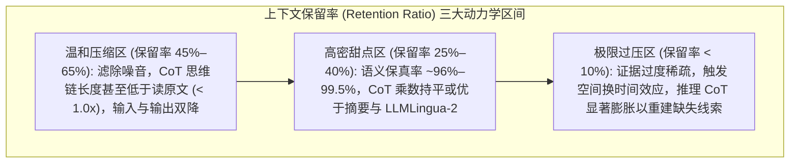

# 第四章：四级压缩档位与推理认知税动力学
**Chapter 04 — Standardized Compression Tiers & Chain-of-Thought Cognitive Dynamics**

> [← 上一章：巴别语三大公理与标准语法算子规范](./03-core-axioms-and-grammar.md) · [返回门户首页 (README)](../README.md) · [下一章：智能体通信协议栈与语义默克尔记忆树 →](./05-agentic-protocol-stack.md)

---

## 4.1 压缩会让大模型“思考更久”吗？（The Space-Time Trade-off Law）

对模型原生压缩最常见的一项工程质疑是：**如果把输入文本压成了高密度符号电报，阅读端大模型在回答问题前，是否必须在内部推理思维链（Chain-of-Thought, CoT）中花费大量输出 Token 将其“脑补解压”回自然语言，从而导致得不偿失（省了便宜的输入 Token，却多花了昂贵的输出推理 Token）？**

基于 `arXiv:2606.19857` 在 **QuALITY（2,128 题）** 与 **MeetingBank（2,586 题）** 上共计 **116 组受控扫描实验**的数据，巴别语体系确立了如下**推理认知税三大动力学定律**：

1. **定律一：无专属表面解码税（Zero Intrinsic Surface Tax）**
   在同等上下文保留率下，巴别语诱发的阅读端 CoT Token 乘数与人类可读摘要（Summary）及抽取式压缩（LLMLingua-2）处于同一水平甚至更低。这证明大模型**不需要**在思维链中把巴别语逐句翻译成英语或中文，而是直接在注意力层消费符号语义图谱。
2. **定律二：温和压缩下的“降噪加速效应”（Denoising Acceleration）**
   当上下文保留率处于 `40%–60%` 区间时，阅读巴别语的推理 CoT 消耗常常**低于未压缩原文基线（乘数 `< 1.0x`）**。原因在于自然语言长文中的寒暄、跑题与重复叙述会分散注意力权重，巴别语剥离冗余后直接暴露出实体与逻辑骨架，反而缩短了模型的证据检索路径。
3. **定律三：极限压缩的“空间-时间权衡边界”（Extreme Compression Boundary）**
   当保留率被强行压低至 `< 10%`（即压缩率 `> 90%`）时，无论采用何种压缩范式，CoT Token 都会急剧攀升。这并非符号形态所致，而是因为**底层证据过度稀疏**，迫使推理模型耗费大量推理步去猜测与缝合上下文缺口。

> [!TIP]
> **全生命周期成本核算定律（Full-Lifecycle Cost Amortization Law）**
> 评估巴别语的真实工程收益，绝不能只看“压缩后文本变短了多少”，而必须计入编译、推理、重试与校验的全链路账本（回应 Chris Clark、Maxime Labonne 等工程研究者的实测关切）：
>
> $$\text{Cost}_{\text{total}} = \underbrace{C_{\text{comp\_in}}(x) + C_{\text{comp\_out}}(z)}_{\text{一次性编译成本}} + N \cdot \Big[ \underbrace{C_{\text{read\_in}}(z)}_{\text{压缩上下文读取}} + \underbrace{C_{\text{CoT\_out}}(R, z)}_{\text{阅读端推理思维链}} \Big] + C_{\text{audit}}$$
>
> * **负收益区（$N = 1$ 的短对话）**：单轮提问一次即丢弃的短提示词，编译开销大于省下的读取开销，**不应启用巴别语**；
> * **高盈亏平衡区（$N \ge 3$ 或超窗口截断场景）**：**“一次编译，N 次复用”**（RAG 知识分片静态预编译、Agent 跨百轮常驻记忆、多智能体广播总线、超过模型物理窗口上限的百万 Token 仓库浓缩）。当复用次数 $N$ 跨越临界点后，总算力与延迟成本呈指数级摊薄。

---

## 4.2 准确率-保留率帕累托前沿（Accuracy-Retention Frontier）

在相同压缩预算下对比三大技术路线：
* **抽取式硬压缩（如 LLMLingua-2）**：通过小模型分类器直接删词。当压缩至原长 `30%` 以下时，句子成分断裂、否定词或关键限定词极易被误删，导致下游 QA 准确率剧烈滑坡（即便在 LLMLingua-2 的原生训练语料库 MeetingBank 上亦如此）。
* **抽象式自然语言摘要（Standard Summarization）**：为了维持“通顺优美的人类句子”，模型不得不把仅剩的 Token 预算浪费在冠词、动词时态与过渡词上，被迫丢弃大量细粒度数值与边缘条件。
* **巴别语表示族（BabelTele Family）**：将全部 Token 预算 100% 分配给核心实体、精确数值与逻辑关系符，在 `25%–35%` 保留率区间形成显著领先的帕累托前沿（代表性测点实现 **27.9% 文本保留率下维持 99.5% 语义保真度**）。

---

## 4.3 巴别语四级标准压缩档位（Standardized Compression Tiers: BT-L0 ~ BT-L3）

为了解决不同模型默认压缩激进度不一（例如实验显示 Gemini 3.1 Pro 默认压缩率往往超过 `95%`，而 GPT-5.4 约为 `75%`）带来的工程不可控问题，巴别语体系定义了**四个标准化压缩等级（Compression Tiers）**：

| 压缩等级 | 档位代号 | 目标保留率（Token 缩减率） | 语法特征与约束强度 | 典型工程适用场景 |
| :--- | :---: | :---: | :--- | :--- |
| **Level 0** | **`BT-L0`** *Telegraphic Prose* | `55% – 70%` *(省 30%–45%)* | 单语种/双语种轻量电报体：仅剥离寒暄、冠词与废话，保留基本短句可读性（近似 1866 电报体）。 | 需要人类运维人员随时肉眼巡检日志的半自动工作流。 |
| **Level 1** | **`BT-L1`** *Structured Hybrid* | `40% – 55%` *(省 45%–60%)* | 结构化混合态：引入模块锚点 `#Sec`、扁平键值 `K=V` 与基础因果符 `=>`，中英术语混排，**触发 CoT 降噪加速（`<1.0x`）**。 | **Agent 会话短期工作记忆**（如约 700–2,000 tokens 的单 Session 折叠，LoCoMo 实测准确率保持 `96.48%`）。 |
| **Level 2** | **`BT-L2`** *Canonical BabelTele* | `25% – 40%` *(省 60%–75%)* | **标准巴别语甜点态（推荐默认）**：全面启用全语种寻优 + 六大逻辑符号簇 + 零括号开销 + 硬数据逐位锁死。 | **多智能体 A2A 协同通信、企业级 RAG 知识分片预编译、跨异构模型状态传递**。 |
| **Level 3** | **`BT-L3`** *Extreme / ASCII Skeleton* | `5% – 25%` *(省 75%–95%)* | 极限坍缩态（含纯 ASCII 骨架子模式 `BT-L3-ASCII`）：单字符锚点 + 极致高密度图谱折叠，仅限顶级强模型编译与消费。 | **突破物理上下文窗口上限**（如将 `1.65M tokens` 超大型代码仓库按 `200K` 分块浓缩塞入 `200K–256K` 窗口模型）。 |

---

> **下一章预告**：确立了语法算子与四级档位之后，巴别语如何无缝嵌入现代智能体工程架构（MCP 与 A2A）？面对无限增长的智能体历史会话，如何像比特币回收磁盘空间一样构建“语义默克尔记忆树”？请阅读 [第五章：智能体通信协议栈与语义默克尔记忆树 →](./05-agentic-protocol-stack.md)。
