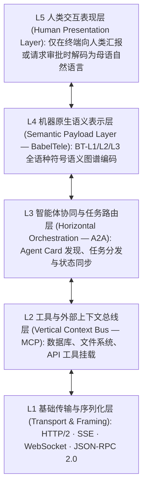
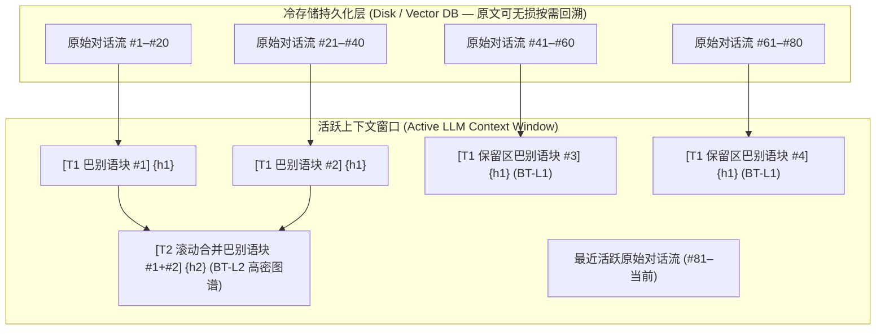

# 第五章：智能体通信协议栈与语义默克尔记忆树
**Chapter 05 — The Agentic Protocol Stack & Semantic Merkle Memory Tree**

> [← 第四章：四级压缩档位与推理认知税动力学](./04-compression-tiers-and-cot.md) · [返回门户首页 (README)](../README.md) · [下一章：异构跨模型共识与三层安全审计网关 →](./06-cross-model-consensus-and-audit.md)

---

## 5.1 智能体五层协议栈（The Five-Layer Agentic Communication Stack）

网络舆论中常有一种误解，认为巴别语（BabelTele）与人类设计的 MCP、A2A 协议是“你死我活的替代关系”。从系统架构视角审视，**MCP/A2A 解决的是“连接与路由”，巴别语解决的是“高密度语义表示”**——三者共同构成了完整的现代智能体通信协议栈（类比互联网 TCP/IP + HTTP + Brotli/Protobuf 体系）：



### 标准消息信封声明规范（Standard Envelope Header）
在兼容现有 A2A 与 MCP JSON-RPC 消息格式的条件下，无需破坏外层路由结构，仅需在内容块元数据中声明巴别语编码头（类比 HTTP 的 `Content-Encoding`）：

```json
{
  "jsonrpc": "2.0",
  "method": "tasks/send",
  "params": {
    "id": "task_9f82a1",
    "message": {
      "role": "agent",
      "metadata": {
        "content_encoding": "babeltele/1.0",
        "bt_tier": "BT-L2",
        "compressor_model": "claude-sonnet-4.6",
        "source_sha256": "e3b0c44298fc1c149afbf4c8996fb924..."
      },
      "parts": [
        {
          "type": "text",
          "text": "#RepoAudit @[Auth=src/auth/jwt.ts]: !vuln(CVE-like):alg=='none'绕过@L142 ∧ exp未校验 => 建议:?header.alg∉[RS256,EdDSA]=>reject(401)."
        }
      ]
    }
  }
}
```

### 多智能体通信实测收益
在 **DeepResearch Bench** 双智能体深度研究协作测试中，将智能体间传递的中间调研报告与状态消息切换为巴别语编码：
* **同构智能体组（Gemini 3.1 Pro $\leftrightarrow$ Gemini 3.1 Pro）**：直接节省 **38.96%** 通信 Token，最终任务得分保持在未压缩基线的 **96.6%**；
* **异构智能体组（Gemini 3.1 Pro $\leftrightarrow$ GPT-5.4）**：节省 **44.21%** 通信 Token，最终任务得分高达未压缩基线的 **99.7%**！证明巴别语可直接充当跨厂商黑盒 API 智能体之间的高带宽“通用工作语”。

---

## 5.2 回收上下文空间：语义默克尔记忆折叠树（Semantic Merkle Folding Tree）

在中本聪的比特币白皮书第七节（*Reclaiming Disk Space*）中，为了防止区块链历史交易无限膨胀撑爆节点硬盘，系统将早期交易哈希逐层向上折叠进 **Merkle Tree（默克尔树）**，修剪掉老旧分支明细而仅保留高阶根摘要。

长程运行的大模型智能体面临完全相同的物理瓶颈：**随着会话持续数天乃至数月，工具输出与历史对话不断追加，必然撞上上下文窗口天花板或注意力退化墙。** 传统滑动窗口（直接丢弃早期历史）会导致灾难性遗忘；传统单次摘要则会因反复概括产生“传话筒失真”。

融合 `arXiv:2606.19857`（LoCoMo 记忆实验）与开源社区 `compressed-context` 的分层架构，巴别语体系正式定义 **语义默克尔记忆折叠树（Semantic Merkle Folding Tree, SMFT）**：



### SMFT 四大运行机制
1. **活跃保留区（Active Frontier）**：最近若干轮正在进行的活跃对话保持原始自然语言，确保当前交互零延迟。
2. **一级检查点折叠（`T1` Folding）**：当活跃区溢出阈值时，后台编译器采用 `BT-L1 / BT-P1`（带潜空间注意力检查清单）将溢出片段编码为自包含的巴别语块 `[T1] {h1}`，原始消息移入本地冷存储并生成唯一块 ID 指针。
3. **高阶树状滚动归并（`T2 / T3` Hierarchical Merge）**：当窗口内 `T1` 块堆积逼近预算上限时，优先合并最古老的相邻同层块，升维为树高 `height = max(child) + 1` 的 `[T2] {h2}` 乃至封顶 `[T3]` 累积记忆块——实现**“近期记忆高分辨率、远期记忆高密度拓扑化”**。
4. **按需无损解引用（Lossless Dereferencing）**：由于巴别语严格保留了所有实体名、精确指标与指针 ID，一旦模型在推理时发现某条远期 `[T3]` 块中的细节需要逐字核对原文，可直接调用 `decompress(block_id)` 从冷存储拉回对应原始片段，彻底消除不可逆信息丢失。

---

## 5.3 突破物理上下文窗口上限（Context Window Extension）

当面对单次输入即远超模型最大物理上下文容量的超大型任务（例如平均体积达 **1.65M（165 万）Tokens** 的完整企业代码仓库问答 `LongBench v2 — Code Repo QA Long`）时，常规模型（窗口上限 200K–256K）只能采取**暴力截断（Truncation）**，直接丢失 85% 以上的代码文件。

采用巴别语 **分块编译浓缩流水线（Chunked BabelTele Compilation）**：
1. 将 `1.65M tokens` 的原始代码库切分为 `200K tokens` 的独立分块；
2. 由高吞吐压缩器并行将每个分块编译为 `BT-L3` 巴别语骨架；
3. 将全部压缩分块拼接后一次性装入 `200K–256K` 窗口的目标推理模型。

| 目标推理模型（物理窗口上限） | 暴力截断基线准确率（Original Truncated） | 巴别语分块浓缩准确率（BabelTele） | 绝对性能提升 |
| :--- | :---: | :---: | :---: |
| **Qwen3.6 Max** (`256K`) | `55.17%` | **`62.07%`** | **`+6.90%`** |
| **GLM-5.1** (`200K`) | `62.07%` | **`72.41%`** | **`+10.34%`** |
| **Kimi 2.5 / 2.6** (`256K`) | `44.82%` | **`48.28%`** | **`+3.46%`** |

在不升级硬件显存、不重训长窗口位置编码的前提下，巴别语相当于在软件表示层将大模型的**有效语义感知视野放大了 4 至 8 倍**。

---

> **下一章预告**：如果由模型 A 压缩的巴别语交给不同厂商的模型 B 读取，哪些组合最稳健？当金融、医疗与安全场景要求 100% 杜绝数值篡改与黑盒暗语风险时，我们如何建立可机检的验证防线？请阅读 [第六章：异构跨模型共识与三层安全审计网关 →](./06-cross-model-consensus-and-audit.md)。
