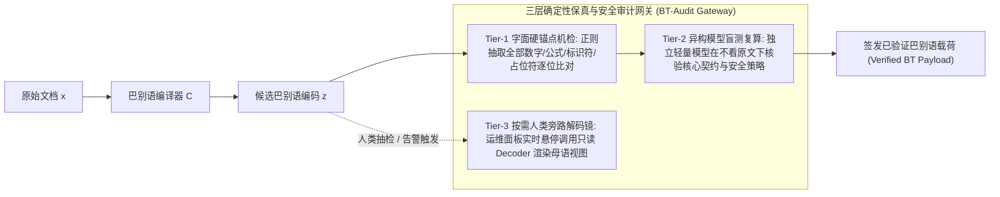

# 第六章：异构跨模型共识与三层安全审计网关
**Chapter 06 — Cross-Model Consensus & Three-Tier Safety Audit Gateway**

> [← 第五章：智能体通信协议栈与语义默克尔记忆树](./05-agentic-protocol-stack.md) · [返回门户首页 (README)](../README.md) · [下一章：巴别语标准编译与解码指令集 →](./07-canonical-instruction-set.md)

---

## 6.1 巴别语是“万能通用密码”吗？——异构跨模型迁移规律

如果一个模型生成的巴别语只能被它自己读懂，那它不过是某种过拟合的“模型私有速记（Model-Private Shorthand）”；唯有能够跨厂商、跨架构、跨参数规模被其他大模型零样本解码，它才真正具备成为**硅基世界通用中间表示（Universal IR）**的资格。

综合 `arXiv:2606.19857` 在 **LongBench v2-Short（180 例）** 与 **QuALITY（214 例）** 上构建的跨模型交叉传输矩阵（涵盖 Gemini 3.1 Pro、GPT-5.4、Claude Sonnet 4.6、DeepSeek-V4-Pro、Qwen3.5/3.6 系列、GLM-5.1、Kimi K2.5/2.6、Doubao-Seed-2.0 等），我们总结出**跨模型共识三大非对称法则**：

### 法则一：压缩器激进度决定跨模型解码门槛
不同模型在执行同一条巴别语压缩指令时，天然表现出截然不同的“压缩性格”：
* **极度激进型（如 Gemini 3.1 Pro）**：默认压缩率往往突破 **95%**（保留率 `< 5%`）。其产出的文本高度凝练，自身读取准确率极高，但交给部分中小尺寸异构模型读取时，会因上下文线索过于精简而增加对方的推理 CoT 负担。
* **稳健均衡型（如 GPT-5.4、Claude Sonnet 4.6）**：默认压缩率控制在 **75% – 85%** 之间。实验矩阵表明，**由 GPT-5.4 与 Claude 压缩生成的巴别语具备全网最强的跨模型可移植性（Broadest Portability）**，几乎所有主流开源与闭源阅读器均能高精度无损消费。
* **语系偏置型（部分单语种权重偏高模型）**：若压缩器自身多语言符号对齐能力不足，产出的非标缩写可能导致其他家族模型出现较大掉点。

> **架构设计启示**：在异构多智能体网络中，应优先指派**多语言与代码符号对齐能力最强的前沿模型（或显式锁定 `BT-L2` 档位）担任“上游编译器（Compressor）”**，下游消费端则可广泛挂载高性价比的轻量推理模型。

### 法则二：阅读端解码能力不唯参数量论（Non-Monotonic Scale Sensitivity）
固定以极激进的 Gemini 3.1 Pro 作为上游压缩器，测试 Qwen 家族从 `14B` 到 `397B` 乃至旗舰预览版的零样本读取表现：

| 下游阅读模型（Reader） | 原文基线准确率 | 读取巴别语准确率 | 绝对变化（pct） | 性能保留率（Retention） |
| :--- | :---: | :---: | :---: | :---: |
| **Qwen3-14B** | `78.97%` | `64.02%` | `-14.95` | `81.07%` |
| **Qwen3.5-27B** | `91.59%` | **`80.84%`** | **`-10.75`** | **`88.26%`** |
| **Qwen3.5-35B-A3B** (MoE) | `90.65%` | `75.70%` | `-14.95` | `83.51%` |
| **Qwen3.5-397B-A17B** (MoE) | `93.93%` | `79.91%` | `-14.02` | `85.07%` |
| **Qwen3.6-Max-Preview** | `90.19%` | `79.44%` | `-10.75` | `88.08%` |

数据显示，面对超过 95% 压缩率的极限异构巴别语，**`27B` 稠密模型（保留率 `88.26%`）的表现甚至优于总参数量高达 `397B` 的稀疏激活 MoE 模型（`85.07%`）**。这说明巴别语解码能力并非简单堆叠参数即可获得，而是高度取决于模型**活跃参数密度（Active Parameter Capacity）与代码/多语种后训练质量**。

---

## 6.2 直面最大隐忧：不可读性带来的安全与失真风险

任何诚实的技术白皮书都必须正视系统潜藏的暗面。当机器间通信从人类可读的自然语言切换为人类肉眼难以辨识的巴别语时，立即浮现出两大核心风险：

1. **硬数据静默漂移风险（Silent Numeric / Boundary Drift）**：在法律合同、金融风控、医疗剂量或系统配置场景下，如果压缩器将 `≤ 20 octets` 漏写成了 `< 20`，人类运维人员扫一眼巴别语很难立刻察觉。
2. **人类监管失明与隐写对齐风险（Audit Opacity & Steganographic Risk）**：MCP 与 A2A 原本为人类保留了一个直观的“明文观察窗”；一旦智能体间全面改用高密度符号流，传统的基于关键词正则过滤的内容安全防火墙（WAF / Guardrails）与人工抽检日志将面临失效风险。

---

## 6.3 巴别语三层确定性保真与安全审计网关（Three-Tier Audit Gateway）

正如比特币通过 **SPV（简化支付验证）与确定性脚本校验** 在无需信任中心机构的前提下保证每一笔账目不可篡改，巴别语体系吸收 `m-rui001/babeltele` 等工程审计实践，在协议层设立**三层确定性保真与安全审计网关（BT-Audit Gateway）**：

### Tier-1：字面硬锚点零开销机检（Deterministic Literal Anchor Check）
无需调用任何大模型，仅用纯标准库确定性代码（耗时 `< 2ms`）即可拦截 90% 以上的数值幻觉：
* 自动从源文本 $x$ 中机械提取**锚点原子表（Anchor Lexicon）**：包括所有精确阿拉伯数字、科学计数法、版本号、百分比、IP/URL、代码函数标识符与 `BIBREF` 占位符；
* 校验压缩产物 $z$ 是否 100% 包含上述硬数据原子（或经声明的精确单位等价换算）；一旦发现数字缺失或被四舍五入，立即打回重编。

### Tier-2：异构交叉盲测与安全护栏扫描（Cross-Model Blind Verification & Guardrail）
* **高敏知识入库校验**：对需要长期写入企业知识库或标准文书库的巴别语条目，使用**与编译器不同家族**的独立验证模型（Verifier LLM），在不接触源文本 $x$ 的盲测条件下回答结构化契约断言（Contract Assertions），全通过方可落盘。
* **语义级安全护栏**：安全审计模型本身也是大模型，完全具备零样本直读巴别语的能力！因此在 MCP/A2A 网关上，只需将传统的“关键词正则防火墙”升级为**轻量级语义护栏模型（Semantic Guardrail Model）**，即可在巴别语状态下直接识别越权指令注入（Prompt Injection）或违规意图，无需强迫业务智能体退回低效的自然语言。

### Tier-3：人类旁路可读观测镜（Human-in-the-Loop Sidecar Decoder）
**“机器内部传输不迁就人类可读性”绝不意味着“剥夺人类的知情权与干预权”**——正如 CPU 内部运行二进制机器码、网络传输采用 TLS 与 Protobuf，而 Wireshark 与调试器随时为人类提供反汇编与可视化解码视图：
* 所有巴别语消息流与记忆树节点均支持挂载**旁路只读解码器（Sidecar Decoder）**；
* 正常运行时零额外开销；仅当人类工程师在监控面板点击某条通信日志或触发安全告警时，按需将其无损渲染回流畅的自然语言供人工审计。

---

> **下一章预告**：理论、算子、协议栈与审计机制已全部就位。在实际工程中，我们究竟该把怎样的系统提示词喂给大模型，才能稳定编译与解码各档位的巴别语？请查阅完整收录的 [第七章：巴别语标准编译与解码指令集 →](./07-canonical-instruction-set.md)。
