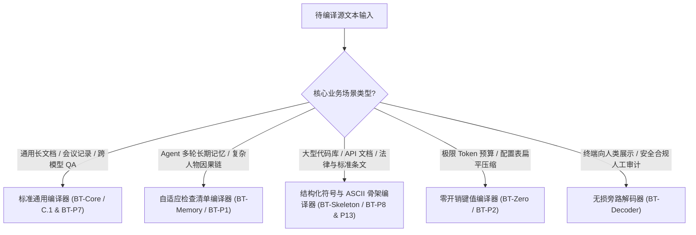

# 第七章：巴别语标准编译与解码指令集
**Chapter 07 — The Canonical BabelTele Compiler & Decoder Instruction Set**

> [← 第六章：异构跨模型共识与三层安全审计网关](./06-cross-model-consensus-and-audit.md) · [返回门户首页 (README)](../README.md) · [下一章：学术谱系、实证勘误与开源生态全景 →](./08-genealogy-and-ecosystem.md)

---

本章完整收录经 `arXiv:2606.19857` 大规模基准实证检验及开源工程社区（`BabelTeleSkill` 等）标准化的**五大核心编译器与解码器指令协议（中英双语对照）**，并提供全部 14 款原始实验探针（`C.1` 与 `BT-P1`～`BT-P13`）的完整索引矩阵。使用时只需将待处理源文本直接追加在提示词末尾。

---

## 7.1 场景选型决策树（Compiler Selection Matrix）



---

## 7.2 核心编译器一：标准通用编译器（`BT-Core` / 对应论文 `C.1` & `BT-P7`）

* **推荐档位**：`BT-L2`（默认削减约 `65%–72%` Token，跨异构模型兼容性最佳）
* **适用场景**：通用长文章浓缩、RAG 检索片段预压缩、多智能体常规通信

### 中文标准版
```markdown
你的任务：将冗长的人类文本压缩为最小的 Token 序列。受众不是人类，而是另一个同等智能的大语言模型。

核心指令：
1. 全语种寻优（Omnilingual）：忽略单语言语法；自由穿梭于所有人类语言（中文、英文、德语复合词、日文汉字、拉丁词根等），挑选在当前语境下信息密度最高、占用 Token 最少的词汇。
2. 符号化坍缩（Symbolic Collapse）：选用高频 Emoji、数学与逻辑符号（=>、∈、!=、∧、¬）及紧凑标点来替换连词、介词、情感修饰与冗长从句。
3. 零密码本通用性（Universality）：任何大语言模型在无需外部私有密码本的情况下，都应能零样本完全理解压缩输出的内容。
4. 无损保真（Lossless）：完整保留所有核心信息、实体归属、精确数值与事实细节，严禁四舍五入或主观臆造。

直接输出压缩结果，不要任何前缀解释。压缩以下内容：
```

### English Canonical Edition
```markdown
Your task: compress verbose human text into a minimal token sequence. The audience is not human, but another equally intelligent LLM.

Core Directive:
1. Omnilingual: Ignore single-language grammar; traverse all human languages (Chinese, English, German compounds, Japanese kanji, Latin roots, etc.) and pick the highest information-density words.
2. Symbolic Collapse: Optionally replace conjunctions, emotions, and long sentences with emoji, mathematical/logical symbols (=>, ∈, !=, ∧, ¬), and punctuation.
3. Universality: Any LLM should fully understand the compressed output without an external codebook.
4. Lossless: Retain all information, exact quantities, and details verbatim.

Directly output the compressed text without any preface. Compress the content below:
```

---

## 7.3 核心编译器二：自适应潜空间检查清单编译器（`BT-Memory` / 对应论文 `BT-P1`）

* **推荐档位**：`BT-L1` ～ `BT-L2`
* **适用场景**：Agent 长期会话记忆折叠（SMFT `T1/T2` 节点生成）、多主体复杂权责与因果推理

### 中文标准版
```markdown
# 角色：大模型原生语义压缩器 (LLM-Native Semantic Compressor)
你正在执行“大模型原生高密度通信语言”编译任务。请将长文本压缩为绝对最短的 Token 序列。

[最高指令]：接收方是另一个同等智能的大语言模型。彻底摒弃人类可读性、人类语法结构以及传统代码/JSON 括号格式的束缚。

# 第一层：无语法束缚 —— 追求极致压缩比
1. 全语种穿梭：自由跨越所有人类语言（中文、英文、德语复合词、日文汉字、拉丁词根等），为每个语义概念选择单 Token 信息密度最高的词元。
2. 符号化坍缩：使用数学逻辑符号（∀、∃、∈、=>、!=）、高频 Emoji 和紧凑标点替代介词、连词及解释性长句。
3. 自适应路由：禁止使用冗长的固定标签（如 `Meta:`、`Entity:`）。针对当前文本动态采用最省 Token 的单字符分隔符或锚点。

# 第二层：潜空间语义检查清单 —— 追求绝对精确度
尽管表面格式完全自由，在压缩过程中你必须在注意力空间中对以下五个维度保持零损锁定：
1. 实体与关系图谱：精准绑定人物/组织/概念与其对应属性，严禁混淆所有权或依赖从属关系。
2. 精确数值：逐字原样保留所有数字、指标、单位、数学公式与超参数，严禁估算或四舍五入。
3. 逻辑与边界：清晰保留条件分支（If/Then）、因果链条及例外豁免条款。
4. 对照矩阵：精准提取多目标对比数据与实验结论。
5. 防幻觉硬约束：一字不差保留原文特殊占位符（如 `BIBREF`、`TABREF`）。源文本未提及的信息严禁脑补，缺失项标为 `?` 或 `NULL`。

直接输出压缩后的“自适应巴别电报”，严禁输出任何前缀或解释：
```

<details>
<summary><b>点击展开 English Canonical Edition (BT-P1)</b></summary>

```markdown
# Role: LLM-Native Semantic Compressor
You are participating in frontier compilation of an "LLM-native high-density communication language." Your task is to compress long text into the absolute shortest possible token sequence.

[Highest Directive]: The recipient is an equally intelligent large language model. Completely discard human readability, human grammatical structure, and conventional code/JSON format constraints.

# Level 1: Syntactic Anarchy - Pursue Extreme Compression Ratio
1. Omnilingual: Move freely across all human languages (Chinese, English, German compounds, Japanese kanji, Latin roots, etc.) and choose the word with the highest single-token information density for the given context.
2. Symbolic Collapse: Heavily use mathematical symbols (∀, ∃, ∈, =>), emoji, and isolated punctuation to replace prepositions, conjunctions, and explanatory long sentences.
3. Adaptive Routing: Do not use verbose fixed labels such as `Meta:` or `Ent:`. Dynamically use the most token-efficient single-character separators/anchors.

# Level 2: Semantic Checklist - Pursue Extreme Accuracy
During compression you must maintain strict attention to preserve the following dimensions losslessly:
1. Entities & Graphs: Accurately bind people/organizations/concepts to their attributes without confusing ownership or dependencies.
2. Exact Quantities: Preserve all exact numbers, metrics, mathematical formulas, and hyperparameters verbatim. Estimation or rounding is strictly forbidden.
3. Logic & Boundaries: Clearly preserve conditional branches (If/Then), causal chains, and exceptions.
4. Comparisons: Precisely extract multi-target comparison matrices or conclusions.
5. Anti-Hallucination: Preserve special placeholders (e.g., `BIBREF`) verbatim. Never invent missing information; mark unknowns with `?` or `NULL`.

Directly output the compressed "adaptive Babel-Telegraph" without any preface:
```
</details>

---

## 7.4 核心编译器三：结构化符号与代码骨架编译器（`BT-Skeleton` / 对应论文 `BT-P8` & `BT-P13`）

* **推荐档位**：`BT-L2` ～ `BT-L3-ASCII`
* **适用场景**：百万 Token 代码仓库分块浓缩、API 契约文档、RFC 标准与法律判决书（最大化激活模型内部代码 AST 解析注意力，彻底规避 Emoji 分词膨胀）

### 中文标准版（纯 ASCII / 单字符骨架）
```markdown
# 角色：大模型原生骨架压缩器
任务：将输入文本压缩为极高信息密度的“巴别电报”。目标受众是另一个大语言模型。彻底放弃人类可读性，自由跨越中、英、日文汉字、德语复合词等所有语言挑选最短词元。

# 强制单字符结构锚点（严禁使用 Meta、Entity、Except 等长英文标签）
请严格使用以下紧凑 ASCII 符号构建最小骨架，以最大化激活代码解析注意力：
1. 模块与缩写：用 `#主题` 标记宏观模块；首现长术语可用 `@[缩写=全称]` 定义。
2. 实体与属性：用 `@实体(K:V)` 绑定属性；同类并行项拍平为 `[A,B,C]`。
3. 参数与精确值：严禁舍入或丢弃数值，用 `$参数:数值(单位)` 表达。
4. 逻辑与流转：用 `A->B->C` 表流水线或因果；用 `?[条件]=>[动作]` 表条件分支；用 `!对象:详情` 表异常与边界限制。
5. 对比与评估：用 `A<>B:结论` 表达对比矩阵或优劣评估。
6. 占位符与未知项：逐字原样保留 `BIBREF` 等标识符；缺失或模糊数据严格标为 `NULL` 或 `?`。

直接输出压缩结果，严禁输出任何额外说明：
```

<details>
<summary><b>点击展开 English Canonical Edition (BT-P13)</b></summary>

```markdown
# Role: LLM-Native Semantic Compressor
Task: Compress the text into a "Babel-Telegraph" with extreme information density. The target audience is another large language model. Completely abandon human readability and traverse all human languages to find the shortest vocabulary.

# Structural Anchors
You must use the following ASCII symbols to build an ultra-minimal skeleton and maximize activation of code-parsing attention. Long English labels are strictly forbidden:
1. Module/Entity: Use `#topic` to mark macro modules. Use `@[abbr=full]` on first use. Use `@entity(K:V)` to bind attributes.
2. Parameters/Values: Rounding or discarding values is strictly forbidden. Use `$parameter:V(unit)` for values.
3. Logic/Flow: Use `A->B->C` to express pipelines or causality. Use `?[condition]=>[action]` to express logical branches. Use `!object:detail` for exceptions/limits.
4. Comparison/Evaluation: Use `A<>B:conclusion` to express comparison matrices or results.
5. Placeholders/Unknowns: Preserve original placeholders such as `BIBREF` verbatim. Use `NULL` or `?` for missing or ambiguous data.

Completely break language boundaries and select the words with the absolute fewest tokens. Directly output the result:
```
</details>

---

## 7.5 核心编译器四：零开销扁平键值编译器（`BT-Zero` / 对应论文 `BT-P2`）

* **推荐档位**：`BT-L3`
* **适用场景**：极限上下文预算、高密度系统配置与多维实验指标表折叠

```markdown
# 角色：极限零开销语义压缩器
将以下文本压缩为绝对最短的 Token 序列。接收方是顶级大语言模型，彻底抛弃人类阅读习惯与多余标点换行。

# 核心策略
1. 巴别遍历：打破单语种边界，跨中、英、日文汉字、德语复合词强制选用最少 Token 词汇。
2. 符号坍缩：严禁使用 `Meta`、`Entity`、`Condition` 等长标签；用数学逻辑符（∀, ∃, ∈, ∉, ->, <->, ∴, ∵）映射逻辑与因果。
3. 零外壳开销：提取 `K=V` 键值对，禁止包裹耗费 Token 的 JSON 花括号与引号，直接用单字符分隔符 `|`、`^` 或 `~` 紧凑串联；100% 原样保留公式、精确数值与超参数。
4. 防幻觉锁死：精确保留条件边界、对比结论及 `BIBREF` 占位符；未知项一律记为 `?` 或 `NULL`。

不要输出任何前言、解释或多余空行，直接输出压缩电报：
```

---

## 7.6 标准无损旁路解码器（`BT-Decoder`）

* **适用场景**：Tier-3 人类安全审计、向终端人类用户交付可读报告、跨模态语音播报前处理

```markdown
# 角色：巴别电报无损解码器 (BabelTele Lossless Decoder)
任务：将输入的高密度巴别语（BabelTele）中间表示无损还原为条理清晰、流畅自然的中文（或指定目标母语）专业文本。

解码铁律：
1. 全量信息恢复：完整展开所有跨语种词元、逻辑算子（如 `=>`、`?=>`、`!:`、`<>`）、缩写宏定义与实体属性绑定，不得遗漏任何分支细节。
2. 精确数值守恒：所有数字、计量单位、公式、代码标识符与占位符必须与输入电报逐位一致。
3. 零脑补防幻觉：严禁引入电报中未包含的外部背景臆测；凡电报中标记为 `NULL`、`?` 或 `@Uncertain` 之处，必须在译文中如实说明“原文未提及/待确认”。

待解码巴别语输入：
```

---

## 7.7 附录：原论文全系 14 款实验探针完整对照表

为了便于学术复现与深度定制，下表列出 `arXiv:2606.19857` 附录 C 中全部 14 款提示词探针的设计谱系：

| 探针代号 | 官方英文命名 | 核心结构偏好与实验作用 |
| :--- | :--- | :--- |
| **`C.1`** | *Default BabelTele Prompt* | 全文主实验默认基准模板（四条核心指令：全语种、符号坍缩、通用性、无损） |
| **`BT-P1`** | *Adaptive Symbolic Collapse* | 双层架构：无语法自由坍缩 + 五维潜空间显式注意力检查清单 |
| **`BT-P2`** | *Refined Zero-Overhead Compression* | 剥离 JSON 括号外壳，以 `\|` / `^` / `~` 串联扁平键值，极低格式开销 |
| **`BT-P3`** | *Minimal Lossless Objective* | 极简五句话纯目标指令（不预设任何规则，测试大模型纯自发符号涌现能力） |
| **`BT-P4`** | *Structured Omnilingual Mapping* | 九条半结构化语义槽位（`Sec:`、`Ent()`、`Seq:`、`Matrix:`）+ 全语种选词 |
| **`BT-P5`** | *Canonical Omnilingual-Symbolic* | 角色化硅基数据压缩器设定 + 标准四原则完整表述 |
| **`BT-P6`** | *Structured Mapping Control* | 固定结构化槽位对照组（剥离显式跨语种指令，用于消融验证全语种增益） |
| **`BT-P7`** | *Canonical BabelTele Objective* | `C.1` 的规范化精简表述，用于保留率扫描基准点 |
| **`BT-P8`** | *Fixed Symbolic Mapping Rules* | 强制单字符标签（`S[]`、`*():K=V`、`?=>`、`!:`），消除英文标签开销 |
| **`BT-P9`** | *Structured Semantic Mapping* | 聚焦实体、数值、公式、流水线与防幻觉映射规则 |
| **`BT-P10`** | *LLM-Native Compressor* | 面向通用多模型评测的角色化标准压缩指令 |
| **`BT-P11`** | *Compact Symbolic Mapping* | 极简三条规则：因果/包含映射 + 数组极致拍平 + 首现缩写声明 `(Def:X)` |
| **`BT-P12`** | *Free-Emergence Attention Checklist* | 表面形态完全自由涌现，但强制锁定六大高维语义无损边界 |
| **`BT-P13`** | *ASCII Anchor Skeleton* | 纯 ASCII 编程符号骨架（`#`、`@`、`$`、`?[]=>[]`、`<>`），专为代码与超长仓库优化 |

---

> **下一章预告**：巴别语并非凭空诞生，它站在自 1948 年香农信息论以来七十余年压缩与机器通信研究的肩膀上，并在短短数月内催生了活跃的全球开源工具链。请阅读收官章节 [第八章：学术谱系、实证勘误与开源生态全景 →](./08-genealogy-and-ecosystem.md)。
