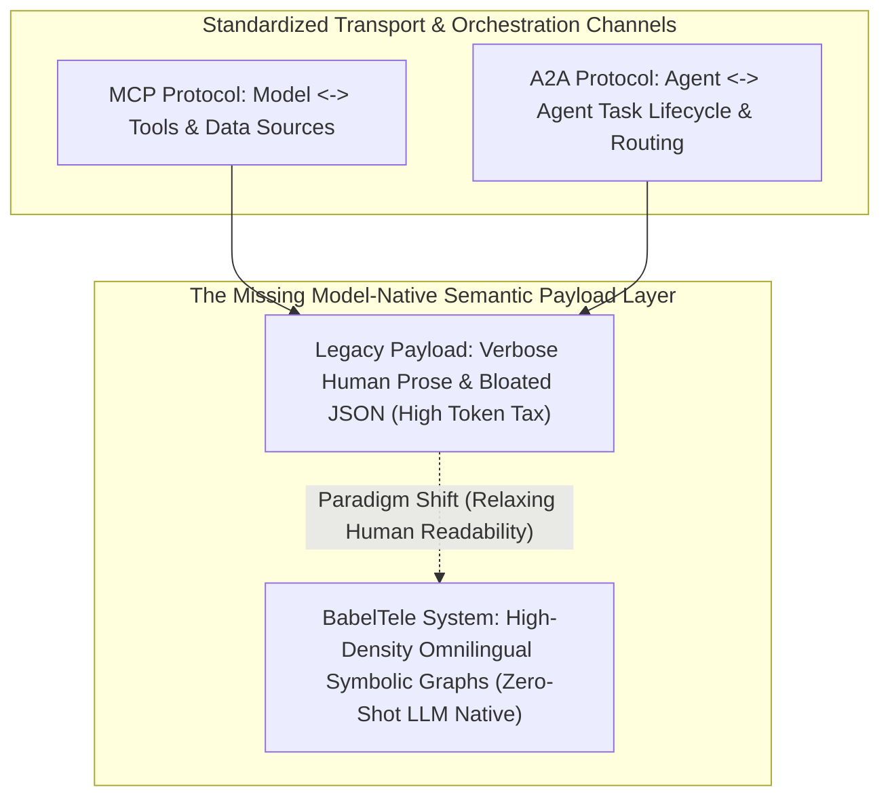

# Chapter 01 — The Anthropocentric Readability Tax & The Babel Metaphor

> [Back to Portal (README_EN)](../README_EN.md) · [Read Single-File Whitepaper (WHITEPAPER_EN)](../WHITEPAPER_EN.md) · [Next: Chapter 02 — Theoretical Foundations →](./02-theoretical-foundations.md)

---

## 1.1 Biological Evolution vs. Silicon Architecture

Since GPT-3 demonstrated few-shot generalization via text prompting, modern AI systems have relied on an unexamined default assumption: **knowledge storage, instruction delivery, inter-agent state synchronization, and tool outputs must all be formatted in human-readable natural language.**

Yet natural language was not engineered as an entropy-optimal data protocol. It evolved under biological constraints to accommodate **linear auditory channels, limited human working memory ($7 \pm 2$ chunks), and social coordination rituals**:

1. **Syntactic Padding**: Articles, prepositions, auxiliary verbs, tense inflections, and clause connectors carry near-zero factual entropy; they exist to pace real-time human cognitive parsing.
2. **Graph Linearization Cost**: Real-world entities, attributes, and causal dependencies form multidimensional directed graphs, yet human prose must spend dozens of connective tokens flattening those graphs into one-dimensional sentences.
3. **Monolingual Lexical Inefficiency**: Any single human language encodes concepts unevenly across domains (e.g., English `photosynthesis` requires a multi-syllable Greek root spelling, whereas Chinese `光合` packs the concept into two dense logograms; conversely, certain vernacular compounds introduce ambiguity where Latin scientific notation or chemical formulas are exact).
4. **Pragmatic & Social Noise**: Polite framing, hedging, transitions, and rhetorical repetition build human rapport but represent pure computational waste in machine-to-machine (M2M) inference.

When **both Sender and Receiver are large language models** equipped with global self-attention and aligned multilingual latent spaces, forcing them to converse in polished human prose imposes what we term **The Anthropocentric Readability Tax**—wasting compute, inflating latency, and exhausting finite context windows.

---

## 1.2 Channels Exist, Language Does Not: Beyond MCP & A2A

In building multi-agent ecosystems, the AI industry has rapidly standardized underlying communication **channels**:

* **MCP (Model Context Protocol)**: Standardizes **vertical connectivity**—how models attach to external databases, local filesystems, and tool APIs.
* **A2A (Agent-to-Agent Protocol)**: Standardizes **horizontal orchestration**—how heterogeneous agents discover capabilities (Agent Cards), delegate tasks, and synchronize lifecycles.

MCP and A2A are the **HTTP and JSON-RPC of the agentic internet**: they define how envelopes are addressed and routed, **not the language written inside the envelope**. Today, MCP tool responses and A2A messages still carry verbose human prose. As long-horizon autonomous agents scale—exchanging hundreds of internal coordination turns per user request and accumulating multi-million-token episodic histories—decoupling **machine-consumed intermediate representations (IR)** from **human-facing terminal rendering** becomes an architectural necessity.

---

## 1.3 The Dual Metaphor of "BabelTele"

In June 2026, researchers across five universities—Shanghai Jiao Tong University, The University of Sydney, Hefei University of Technology, Xi'an Jiaotong University, and Nanjing University—published *Large Language Models Do Not Always Need Readable Language* (`arXiv:2606.19857`), coining and empirically validating **BabelTele**.

The name unites two milestones in communication history:

| Dimension | Historical Archetype | Reversal in the Silicon Era |
| :--- | :--- | :--- |
| **Babel** *(Tower of Babel)* | Humanity fractured into mutually unintelligible linguistic silos, halting collective construction. | Multilingual pretraining aligns dozens of human languages into a single shared latent manifold. LLMs **reverse Babel**, seamlessly traversing English, Chinese, German compounds, Japanese kanji, and math symbols to pick the highest-density token entry. |
| **Tele** *(1866 Telegraphese)* | Metered transatlantic telegraph cables forced operators to strip articles and politeness (*"I am well and hope you are too"* $\rightarrow$ *"WELL HOPE SAME"*). | Under strict context-window and KV-cache budgets, LLMs push telegraphic economy to its theoretical limit—replacing linear prose with compact relational graphs. |

---

## 1.4 Why a "Bitcoin-Style" System Whitepaper?

Prior to Satoshi Nakamoto's 2008 *Bitcoin: A Peer-to-Peer Electronic Cash System*, cryptographic hash functions, Merkle trees (1979), timestamp servers (1991), Hashcash (1997), and b-money (1998) already existed as separate research results. Bitcoin's enduring contribution was **synthesizing scattered primitives into a self-contained, verifiable, end-to-end architectural specification**.

BabelTele stands at an analogous inflection point:
* **Empirical Research** (`arXiv:2606.19857`, LLMLingua-2, Gist Tokens, Latent Collaboration) has proven that human readability and model recoverability can be decoupled;
* **Open-Source Pioneers** have built Rust token filters, LangChain middleware, hierarchical context folders, and IDE compaction hooks;
* **Unified Engineering & Governance Standards** remain absent: How do we avoid BPE byte-fallback inflation? How do we prevent extreme compression from triggering Chain-of-Thought (CoT) reasoning explosion? Above all, **how do humans maintain deterministic factual verification and safety oversight when agents communicate in opaque symbolic streams?**

This whitepaper synthesizes all extant research and engineering discoveries into **The BabelTele System (`BT-Spec v1.0`)**—a complete black-box-compatible protocol encompassing information-theoretic foundations, three formal axioms, six operator clusters, four compression tiers, MCP/A2A envelope integration, Semantic Merkle Folding Trees, and a Three-Tier Safety Audit Gateway.

---

> **Next Chapter**: [Chapter 02 — Information-Theoretical Foundations & The Decoupling Principle →](./02-theoretical-foundations.md)
