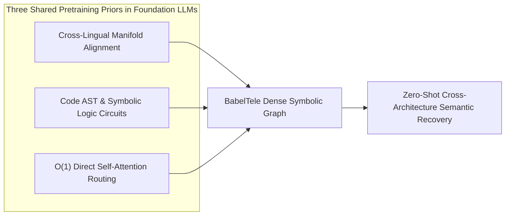

# Chapter 02 — Information-Theoretical Foundations & The Decoupling Principle

> [← Chapter 01: Manifesto & Problem](./01-manifesto-and-problem.md) · [Back to Portal (README_EN)](../README_EN.md) · [Next: Chapter 03 — Core Axioms & Grammar →](./03-core-axioms-and-grammar.md)

---

## 2.1 Readability-Relaxed Semantic Projection

In classical context compression, given a source document $x \in \mathcal{V}^*$ of token length $L(x)$, a compressor $C$ generates a shorter discrete sequence $z = C(x)$ ($L(z) \ll L(x)$) consumed by a reader model $R$ on downstream task queries $q$.

Conventional extractive and abstractive methods (e.g., Selective Context, LLMLingua, RECOMP) implicitly enforce a strong **human-readability prior**—constraining $z$ to remain inside the high-likelihood natural-language manifold $P_{\text{NL}}$:

$$\min_{z} \; L(z) \quad \text{s.t.} \quad \mathcal{D}_{\text{sem}}\big(R(x, q),\, R(z, q)\big) \le \epsilon \;\;\wedge\;\; H_{\text{human}}(z) \ge \tau_{\text{read}}$$

**The foundational insight of BabelTele is the removal of $H_{\text{human}}(z) \ge \tau_{\text{read}}$ whenever $R$ is an instruction-tuned LLM.** Optimization reduces to a pure **Rate-Distortion Semantic Projection** over total inference cost:

$$z^* = \arg\min_{z \in \mathcal{V}^*} \Big[ L_{\text{tok}}(z) + \beta \cdot L_{\text{CoT}}(R, z) \Big] \quad \text{s.t.} \quad \mathcal{F}_{\text{sem}}(R; z, x) \ge 1 - \epsilon$$

Crucially, the second-order term $\beta \cdot L_{\text{CoT}}(R, z)$ accounts for reader-side reasoning overhead: true system optimality minimizes the **joint sum of compressed input context and downstream Chain-of-Thought generation**, rather than driving input length blindly toward zero.

---

## 2.2 The Tripartite Decoupling Principle

A pervasive intuition in NLP assumed that if a text sequence exhibits extreme Perplexity (PPL) under base language models or looks like unreadable gibberish to humans, LLMs must likewise fail to extract meaning from it. Controlled experiments on QuALITY alongside paid university-student questionnaires (`arXiv:2606.19857`) refute this assumption, establishing the **Tripartite Decoupling Principle**:

> [!IMPORTANT]
> **The Tripartite Decoupling Principle**
> Within the discrete token space of modern instruction-tuned LLMs, three properties that co-occur in ordinary prose can be cleanly separated:
> 1. **Human Surface Readability**
> 2. **Natural-Language Distributional Typicality (Base-Model PPL)**
> 3. **Model-Side Semantic Recoverability**

### Empirical Proof 1: Collapse of Human Surface Readability
Measured via the **Dale-Chall Readability Score** (where standard college-level English prose scores `9.0–9.9` and higher scores signify greater opacity):

| Representation Variant | Passages ($n$) | Dale-Chall Score (↑ Less Readable) | Difficult-Word Ratio |
| :--- | :---: | :---: | :---: |
| **Original Natural Language** | 10 | `10.28` | `35.97%` |
| **Natural-Language Summary** | 10 | `13.51` | `56.34%` |
| **BabelTele Representation** | 10 | **`16.70`** | **`80.19%`** |

### Empirical Proof 2: 13x–20x Perplexity Surge Across Base Models
While natural-language summaries remain close to original text perplexity (`-6.2%` to `+17.5%`), BabelTele triggers an **order-of-magnitude PPL explosion** across eight diverse base models:

| Evaluator Base Model | Original PPL | Summary PPL (Rel. $\Delta$) | BabelTele PPL (Rel. $\Delta$) |
| :--- | :---: | :---: | :---: |
| **Llama-3-8B** | `9.63` | `11.32` (+17.5%) | **`176.60` (+1,733.9%)** |
| **Qwen2-7B** | `10.93` | `12.44` (+13.8%) | **`236.23` (+2,061.1%)** |
| **Qwen2.5-7B** | `10.43` | `11.56` (+10.8%) | **`209.30` (+1,906.7%)** |
| **Qwen3-8B** | `14.94` | `15.22` (+1.9%) | **`301.22` (+1,916.2%)** |
| **Qwen3-32B** | `11.80` | `11.07` (-6.2%) | **`220.76` (+1,770.8%)** |
| **Kimi K2.6** | `6.93` | `7.76` (+11.9%) | **`127.96` (+1,746.5%)** |
| **DeepSeek V4 Pro** | `7.67` | `7.75` (+1.1%) | **`108.95` (+1,320.5%)** |
| **GLM 5.1** | `7.89` | `8.40` (+6.5%) | **`148.23` (+1,778.7%)** |

High PPL indicates low *surface generation probability* under ordinary prose priors—**not** absence of recoverable semantic structure.

### Empirical Proof 3: Human Breakdown vs. LLM Fidelity
In paid human questionnaires, university students reading BabelTele suffered pronounced QA accuracy degradation and high subjective difficulty; meanwhile, **Gemini 3.1 Pro** maintained near-original accuracy—retaining **99.5% semantic fidelity** at **27.9%** of original text length.

---

## 2.3 The Latent Isomorphism Hypothesis: Why Do LLMs Understand It Zero-Shot?

Why can heterogeneous LLMs decode each other's BabelTele strings zero-shot without fine-tuning? Three structural priors shared across modern foundation models explain this capability:

1. **Cross-Lingual Isomorphism**: Multilingual pretraining maps `administration`, `行政`, German compounds, and Latin roots into overlapping hidden-state neighborhoods. Switching surface script sheds spelling tokens without altering deep semantic activations.
2. **Code & Formal Logic Attention Heads**: Pretraining on billions of lines of source code and mathematics equips transformers with specialized structural induction heads. Replacing verbose clauses with `?cond => act` or `@Ent(K=V)` bypasses natural-language ambiguity and directly activates high-precision symbolic parsing circuits.
3. **Direct Attention Graph Matching**: Unlike human ears that require linear grammatical glue, self-attention links any two tokens in $O(1)$ path length. BabelTele strips linear prose padding to expose an **explicit sparse semantic graph** native to attention mechanisms.

---

> **Next Chapter**: [Chapter 03 — The Three Core Axioms & Canonical Grammar Specification (BT-Spec v1.0) →](./03-core-axioms-and-grammar.md)
