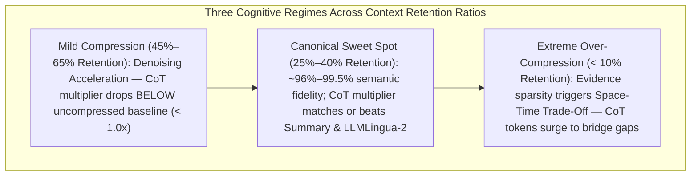

# Chapter 04 — Standardized Compression Tiers & Chain-of-Thought Cognitive Dynamics

> [← Chapter 03: Core Axioms & Grammar](./03-core-axioms-and-grammar.md) · [Back to Portal (README_EN)](../README_EN.md) · [Next: Chapter 05 — Agentic Protocol Stack & SMFT →](./05-agentic-protocol-stack.md)

---

## 4.1 Does Compression Force Models to "Think Harder"? (The Space-Time Trade-Off)

A critical systems question is whether feeding dense symbolic text into an LLM forces the reader model to spend extra **Chain-of-Thought (CoT) reasoning tokens** mentally decompressing the text back into natural language—wiping out cheap input-token savings with expensive output-token generation.

Synthesizing **116 experimental runs** across **2,128 QuALITY questions** and **2,586 MeetingBank questions** (`arXiv:2606.19857` §4.3), `BT-Spec v1.0` codifies three laws of reasoning overhead:

1. **Law I: Zero Intrinsic Surface Decoding Tax**  
   At matched retention ratios, BabelTele induces CoT multipliers comparable to or lower than human-readable summaries and LLMLingua-2. LLMs do **not** translate BabelTele into English prose inside CoT; they reason directly over the symbolic graph.
2. **Law II: Denoising Acceleration in Mild Compression**  
   Between `40%` and `60%` retention, BabelTele frequently achieves a CoT token multiplier **`< 1.0x`** relative to reading uncompressed text. Stripping conversational fluff and distracting tangents sharpens attention routing and shortens reasoning traces.
3. **Law III: The Extreme Sparsity Boundary**  
   When retention drops below `10%` (`>90%` compression), CoT tokens rise sharply across *all* compression methods as models expend reasoning steps reconstructing sparse evidence.

> [!TIP]
> **Full-Lifecycle Cost Amortization Law**
> Real production ROI must account for compilation prefill/decode, $N$-time downstream consumption, reader CoT overhead, and verification:
>
> $$\text{Cost}_{\text{total}} = \underbrace{C_{\text{comp\_in}}(x) + C_{\text{comp\_out}}(z)}_{\text{One-Time Compilation}} + N \cdot \Big[ \underbrace{C_{\text{read\_in}}(z)}_{\text{Compressed Read}} + \underbrace{C_{\text{CoT\_out}}(R, z)}_{\text{Reader CoT}} \Big] + C_{\text{audit}}$$
>
> * **Negative ROI ($N = 1$ short prompts)**: Never invoke an LLM compressor on a single-use short prompt where compilation cost exceeds read savings.
> * **High ROI ($N \ge 3$ or Window-Overflow)**: Pre-compiling static RAG corpora, persistent multi-turn agent memory, multi-agent broadcast buses, and multi-million-token repository compression amortizes compilation cost rapidly.

---

## 4.2 Standardized Compression Tiers (`BT-L0` ~ `BT-L3`)

Because raw LLM compressors vary wildly in default aggressiveness (e.g., Gemini 3.1 Pro exceeds `95%` compression by default while GPT-5.4 averages `~75%`), `BT-Spec v1.0` standardizes four operational tiers:

| Tier | Identifier | Target Retention (Token Savings) | Structural Profile | Primary Engineering Use Case |
| :--- | :---: | :---: | :--- | :--- |
| **Level 0** | **`BT-L0`** *Telegraphic Prose* | `55% – 70%` *(Saves 30%–45%)* | Monolingual telegraphese: drops articles, filler, and politeness while keeping human skimmability. | Human-monitored semi-automated operational logs. |
| **Level 1** | **`BT-L1`** *Structured Hybrid* | `40% – 55%` *(Saves 45%–60%)* | Section headers `#Sec`, flat `K=V` bindings, causal arrows `=>`; triggers **CoT denoising (`<1.0x`)**. | **Short-session working memory** (~700–2,000 token dialogue sessions; `96.48%` LoCoMo retention). |
| **Level 2** | **`BT-L2`** *Canonical BabelTele* | `25% – 40%` *(Saves 60%–75%)* | **Recommended Default**: Full omnilingual token minimization + six operator clusters + verbatim hard-data lock. | **A2A multi-agent messaging, pre-compiled RAG chunks, cross-model state transfer**. |
| **Level 3** | **`BT-L3`** *Extreme / ASCII Skeleton* | `5% – 25%` *(Saves 75%–95%)* | Ultra-dense single-char ASCII skeleton (`BT-L3-ASCII`); reserved for frontier compressor-reader pairs. | **Breaking physical context limits** (e.g., fitting `1.65M-token` code repos into `200K–256K` windows). |

---

> **Next Chapter**: [Chapter 05 — The Agentic Protocol Stack & Semantic Merkle Memory Tree →](./05-agentic-protocol-stack.md)
