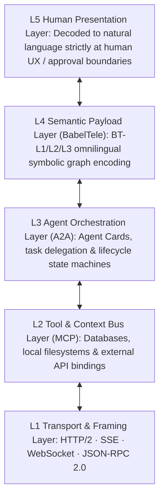
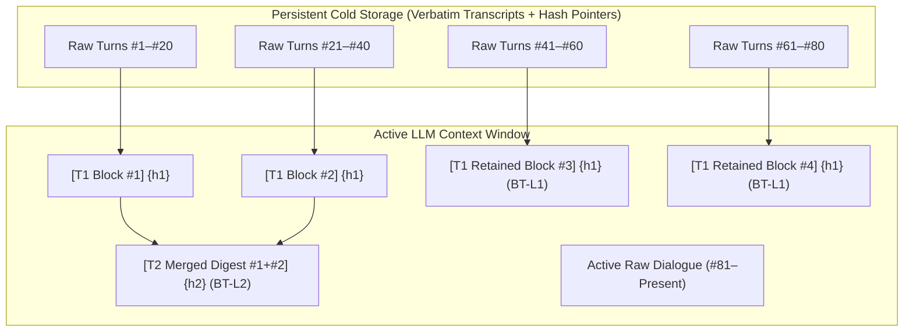

# Chapter 05 — The Agentic Protocol Stack & Semantic Merkle Memory Tree

> [← Chapter 04: Compression Tiers & CoT Dynamics](./04-compression-tiers-and-cot.md) · [Back to Portal (README_EN)](../README_EN.md) · [Next: Chapter 06 — Cross-Model Consensus & Audit Gateway →](./06-cross-model-consensus-and-audit.md)

---

## 5.1 The Five-Layer Agentic Communication Stack

Popular commentary sometimes frames BabelTele as an adversarial replacement that will "wipe out" human-designed protocols like MCP and A2A. Architecturally, **MCP and A2A govern connectivity and task routing, whereas BabelTele governs semantic payload density**—mirroring how Protobuf or Brotli operates atop HTTP/2 and TCP/IP:



### Standard JSON-RPC Envelope Metadata (`content_encoding`)
BabelTele integrates non-invasively into standard A2A and MCP JSON-RPC envelopes via metadata headers:

```json
{
  "jsonrpc": "2.0",
  "method": "tasks/send",
  "params": {
    "id": "task_9f82a1",
    "message": {
      "role": "agent",
      "metadata": {
        "content_encoding": "babeltele/1.0",
        "bt_tier": "BT-L2",
        "compressor_model": "claude-sonnet-4.6",
        "source_sha256": "e3b0c44298fc1c149afbf4c8996fb924..."
      },
      "parts": [
        {
          "type": "text",
          "text": "#RepoAudit @[Auth=src/auth/jwt.ts]: !vuln:alg=='none'@L142 & !exp_check => fix:?header.alg∉[RS256,EdDSA]=>reject(401)."
        }
      ]
    }
  }
}
```

### Multi-Agent Empirical Gains (DeepResearch Bench)
* **Homogeneous Multi-Agent (Gemini 3.1 Pro $\leftrightarrow$ Gemini 3.1 Pro)**: **38.96%** communication token reduction at **96.6%** baseline score retention.
* **Heterogeneous Multi-Agent (Gemini 3.1 Pro $\leftrightarrow$ GPT-5.4)**: **44.21%** communication token reduction at **99.7%** baseline score retention.

---

## 5.2 Reclaiming Context Space: Semantic Merkle Folding Tree (SMFT)

In §7 of the Bitcoin Whitepaper (*Reclaiming Disk Space*), Satoshi Nakamoto introduced Merkle Tree pruning so historical transactions could be hashed upward without exhausting node disk storage. Long-horizon LLM agents confront an identical bottleneck: **unbounded dialogue and tool-output streams rapidly saturate context windows and degrade retrieval fidelity.**

Synthesizing `arXiv:2606.19857` (LoCoMo memory evaluation) and open-source hierarchical folding (`compressed-context`), `BT-Spec v1.0` defines the **Semantic Merkle Folding Tree (SMFT)**:



1. **Active Frontier**: Ongoing turns stay in raw natural language for zero-latency responsiveness.
2. **`T1` Checkpoint Folding**: Overflowing turns are compiled via `BT-Memory` (`BT-P1`) into self-contained `[T1] {h1}` blocks while raw messages move to persistent cold storage.
3. **`T2 / T3` Hierarchical Merging**: When `T1` blocks approach token budget ceilings, oldest sibling blocks merge recursively into `[T2] {h2}` and top-level rolling `[T3]` digests—yielding **high resolution for recent memory and compact topology for distant history**.
4. **Lossless Dereferencing**: Because exact entity identifiers, quantities, and block IDs remain intact, the agent can invoke `decompress(block_id)` whenever verbatim source inspection is required.

---

## 5.3 Breaking Physical Context Limits (`1.65M` Code Repo QA)

When input repositories exceed physical context windows—such as **LongBench v2 Code Repo QA Long** (averaging **1.65M tokens** vs. `200K–256K` model limits)—naive truncation discards over 85% of the codebase. Chunking the repository into `200K` segments, compiling each into `BT-L3`, and concatenating the dense outputs yields dramatic accuracy gains over truncation:

| Target Reader Model (Window Limit) | Original Truncated Accuracy | BabelTele Chunk-Compiled Accuracy | Net Gain |
| :--- | :---: | :---: | :---: |
| **Qwen3.6 Max** (`256K`) | `55.17%` | **`62.07%`** | **`+6.90%`** |
| **GLM-5.1** (`200K`) | `62.07%` | **`72.41%`** | **`+10.34%`** |
| **Kimi 2.5 / 2.6** (`256K`) | `44.82%` | **`48.28%`** | **`+3.46%`** |

---

> **Next Chapter**: [Chapter 06 — Cross-Model Consensus & Three-Tier Safety Audit Gateway →](./06-cross-model-consensus-and-audit.md)
