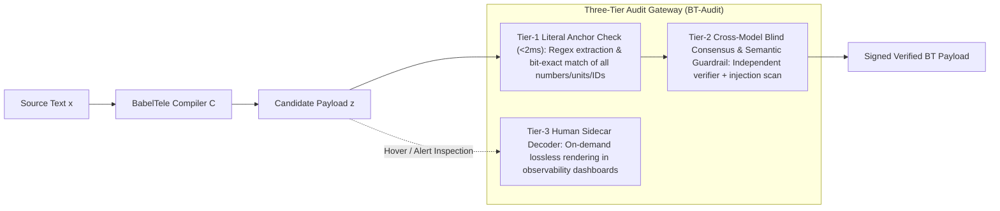

# Chapter 06 — Cross-Model Consensus & Three-Tier Safety Audit Gateway

> [← Chapter 05: Agentic Protocol Stack & SMFT](./05-agentic-protocol-stack.md) · [Back to Portal (README_EN)](../README_EN.md) · [Next: Chapter 07 — Canonical Instruction Set →](./07-canonical-instruction-set.md)

---

## 6.1 Is BabelTele a Universal Cipher? Cross-Model Portability Laws

If compressed strings could only be read by the exact model that generated them, BabelTele would be merely a brittle private shorthand. Cross-model transfer evaluations across 19 proprietary and open-weight models on LongBench v2-Short (180 samples) and QuALITY (214 QA items) establish **two asymmetric laws of cross-model consensus**:

### Law I: Compressor Aggressiveness Shapes Reader Portability
* **Ultra-Aggressive Compressors (e.g., Gemini 3.1 Pro, `>95%` default compression)**: Retain high self-reading fidelity but impose steeper reasoning demands on smaller heterogeneous readers.
* **Balanced High-Portability Compressors (e.g., GPT-5.4 at `~75%`, Claude Sonnet 4.6 at `~80–85%`)**: Produce symbolic graphs with the **broadest zero-shot portability** across open and closed model families.
* **Architectural Rule**: In heterogeneous multi-agent clusters, assign models with balanced multilingual-symbolic alignment (or lock `BT-L2` explicitly) as upstream compilers so downstream lightweight models can decode effortlessly.

### Law II: Active Capacity Over Raw Parameter Count
Fixing an aggressive Gemini 3.1 Pro upstream compressor and varying Qwen-family readers on QuALITY reveals non-monotonic scale sensitivity:

| Downstream Reader Model | Uncompressed Accuracy | BabelTele Accuracy | Drop (pct) | Relative Retention |
| :--- | :---: | :---: | :---: | :---: |
| **Qwen3-14B** | `78.97%` | `64.02%` | `-14.95` | `81.07%` |
| **Qwen3.5-27B** (Dense) | `91.59%` | **`80.84%`** | **`-10.75`** | **`88.26%`** |
| **Qwen3.5-35B-A3B** (MoE) | `90.65%` | `75.70%` | `-14.95` | `83.51%` |
| **Qwen3.5-397B-A17B** (MoE) | `93.93%` | `79.91%` | `-14.02` | `85.07%` |
| **Qwen3.6-Max-Preview** | `90.19%` | `79.44%` | `-10.75` | `88.08%` |

Notably, dense `Qwen3.5-27B` (`88.26%` retention) outperforms sparse MoE `Qwen3.5-397B-A17B` (`85.07%`), indicating that **active parameter density and symbolic post-training quality** govern decoding resilience more strongly than total parameter count alone.

---

## 6.2 Confronting Opacity: Numeric Drift & Alignment Risks

Replacing human-readable prose with dense symbolic strings introduces two legitimate engineering concerns:
1. **Silent Numeric or Boundary Drift**: Subtle operator flips (e.g., `<= 20` vs. `< 20`) in legal, medical, or financial payloads are hard for human operators to spot by naked eye.
2. **Audit Opacity**: Keyword-regex firewalls (legacy WAFs) and casual human log skimming lose visibility if inter-agent payloads are opaque.

---

## 6.3 The Three-Tier Deterministic Fidelity & Safety Audit Gateway

Analogous to Bitcoin's **Simplified Payment Verification (SPV)** and deterministic script validation, `BT-Spec v1.0` pairs model-native compression with a mandatory **Three-Tier Audit Gateway**:

1. **Tier-1 Deterministic Literal Anchor Check (`< 2ms`, Zero LLM Cost)**  
   Pure standard-library code mechanically extracts an **Anchor Lexicon** from source $x$—every number, percentage, scientific exponent, version tag, code identifier, and `BIBREF` token—and verifies bit-exact presence in $z$. Any unapproved rounding or omission triggers immediate rejection.
2. **Tier-2 Cross-Model Blind Verification & Semantic Guardrails**  
   * **Knowledge Commits**: High-stakes corpus entries are audited blindly (without source access) against deterministic contract assertions by an independent model family.
   * **Semantic Guardrails**: Because safety-classifier LLMs also read BabelTele zero-shot, upgrading gateway firewalls from brittle keyword regexes to lightweight semantic guardrail models enables real-time prompt-injection and policy enforcement directly over compressed traffic.
3. **Tier-3 Human-in-the-Loop Sidecar Decoder**  
   Just as CPUs execute binary machine code while debuggers disassemble it on demand, observability dashboards attach a read-only **Sidecar Decoder**—incurring zero runtime overhead during normal machine execution while rendering crystal-clear natural language whenever a human engineer inspects a trace.

---

> **Next Chapter**: [Chapter 07 — The Canonical BabelTele Compiler & Decoder Instruction Set →](./07-canonical-instruction-set.md)
